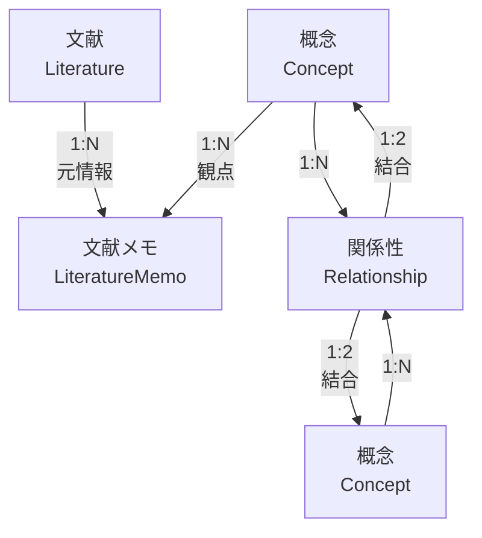

# データモデル

## 前提

<!-- PREMISE_BEGIN: key-abstractions -->

CogitoWeave システムは**概念ベース知識体系構築システム**として抽象化される。

中核的価値は、個人の思考を「概念」という抽象化を通じて構造化し、外部情報を自分の理解に統合する仕組みの提供にある。

### 主要抽象化

#### 1. 概念 (Concept)

思考の最小単位として知識体系の中心に位置する抽象化

- 外部情報を個人の理解に変換するフィルター
- 知識統合の基点として機能する
- 他の概念との関係によって意味を形成する

#### 2. 文献メモ (Literature Memo)

概念に紐づく具体的知識内容を表現する抽象化

- 外部文献(Web 記事、書籍等)を個人の観点で解釈した結果
- LLM 協働により効率的に作成され個人の理解で修正される
- 概念の理解を深化させる具体例や体験を蓄積する

#### 3. 関係性 (Relationship)

概念間の関連性を表現し知識ネットワークを形成する抽象化

- 個人的な関係語彙による柔軟な関係定義
- 空間配置による直感的な関係性発見を支援
- 断片的知識を構造化された思考地図に変換する

### 抽象化の相互作用

- **外部文献** → **概念フィルター** → **文献メモ** (情報の個人化プロセス)
- **概念** ↔ **関係性** ↔ **概念** (知識ネットワーク形成プロセス)
- **空間配置** → **関係性発見** → **思考地図構築** (直感的構造化プロセス)

これらの抽象化により、外部情報の受動的消費から、個人の理解体系への能動的統合への転換が実現される。

<!-- PREMISE_END: key-abstractions -->

## 論理

DOA(Data Oriented Approach)に基づき、データ構造をシステム設計の基盤として確立する。概念中心設計により、データモデルが思考支援システムの論理構造を直接反映する。

第一に、前提の各抽象化をデータとして表現する必要性を検討する。

概念(Concept)は「思考の最小単位」として定義されており、個々の概念を識別・管理するためには一意な識別子が必要である。

同様に、文献メモ(Literature Memo)は「概念に紐づく具体的知識内容」として定義されており、1 つの概念に複数の文献メモが紐づく構造から、文献メモも独立した識別子を持つ必要がある。

関係性(Relationship)は「概念間の関連性を表現し知識ネットワークを形成する」ものであり、複数の概念間関係を管理するためには関係性自体を識別可能なデータ要素とする必要がある。

さらに前提の「抽象化の相互作用」では「外部文献 → 概念フィルター → 文献メモ」というプロセスが示されている。外部文献は文献メモの生成元として参照されるため、書誌情報(URL、タイトル等)をデータ要素として管理する必要がある。

第二に、エンティティ分離の正規化根拠を確認する。

前提では文献メモは「概念の理解を深化させる具体例や体験を蓄積する」と定義されている。「蓄積する」という表現から、1 つの概念に対して複数の文献メモが存在する構造が導出される。したがって概念と文献メモは 1:N 関係である。文献メモに概念の属性(名前、説明等)を埋め込むと、同一概念に紐づく複数の文献メモで概念情報が重複する。これは第 2 正規形違反であり、概念は独立エンティティとして分離する必要がある。

同様に、前提では外部文献(Web 記事、書籍等)から文献メモが作成されると示されている。

外部文献を識別するための書誌情報として、Web 記事では URL とタイトル、書籍では ISBN、著者、出版社、出版年等が必要である。

1 つの外部文献から複数の観点(概念)で文献メモが作成される可能性があるため、文献メモごとに書誌情報を持つと同一文献の情報が重複する。これは第 2 正規形違反である。

したがって、外部文献の書誌情報は独立した Literature エンティティとして分離する必要がある。

Literature エンティティは「文献の識別情報」を表現する。Web 記事の場合は URL とタイトルで文献を識別する。同一 URL であれば、異なる時点で取得されても同一の Literature として扱う。「いつ取得したか」は文献メモの作成日時で表現されるため、Literature エンティティに取得日時を持つ必要はない。

書籍の場合は ISBN で文献を一意に識別できるため、同一 ISBN であれば同一の Literature として扱う。

第三に、関係性エンティティの必要性を検討する。

前提では「概念間の関連性を表現し知識ネットワークを形成する」と定義されており、これは概念間の多対多関係である。

1 つの概念は複数の他の概念と関係を持ち、かつ「個人的な関係語彙による柔軟な関係定義」が求められている。関係そのものが属性(関係名、説明等)を持つため、概念エンティティに埋め込むことはできず、独立した Relationship エンティティとして表現する必要がある。

これにより無向グラフ構造が実現され、前提の「空間配置による直感的な関係性発見」を支援するデータ構造が構築される。

### 概念的データ構造

CogitoWeave システムの論理的データ構造は、4 つのコア概念とその関係性で表現される：

**概念エンティティ (Concept)**:

- 思考の最小単位として機能
- 知識体系の中心的存在
- 他の概念との関係によって意味を形成
- 外部情報を個人の理解に変換する観点

**文献エンティティ (Literature)**:

- 外部文献の書誌情報
- 複数の概念観点からアクセス可能
- システム外部の知識源との接点

**文献メモエンティティ (LiteratureMemo)**:

- 特定概念の観点による文献の解釈結果
- ツェッテルカステン方式による知識蓄積
- LLM 協働と個人理解の融合

**関係性エンティティ (Relationship)**:

- 概念間の意味的連関を表現
- 無向グラフによる知識ネットワーク形成
- 個人的語彙による関係定義

**関係性の多重度**:

- **概念 ← 文献メモ (1:N)**: 1 つの概念に複数の文献メモが関連付けられる
- **文献 ← 文献メモ (1:N)**: 1 つの文献から複数の観点で文献メモが作成される
- **概念 ← 関係性 → 概念 (1:N:1)**: 1 つの関係性は必ず 2 つの概念を結合し、1 つの概念は複数の関係性に参加する

この構造は実装技術に依存せず、あらゆるデータストレージ方式で具現化可能である。

### データフローパターン

**外部情報の個人化プロセス**:

- 外部文献 → 概念フィルター適用 → 文献メモ生成 → 個人理解の蓄積

**知識ネットワーク形成プロセス**:

- 概念間関係の発見 → 関係性定義 → 知識構造の構築

**直感的構造化プロセス**:

- 空間配置操作(一時的) → 関係性の発見 → 思考地図の構築

## 結論

CogitoWeave のデータモデルは概念中心設計により以下の 4 つのコアエンティティで構成される:

### コアエンティティ定義

<!-- GLOBAL_CONCLUSION_BEGIN: concept-entity -->

概念エンティティ(Concept):

- 思考の最小単位として知識体系の中心に位置する
- 基本属性: ID、名前、説明、作成日時、更新日時
- 他の概念との関係性によって意味を形成する
- 外部情報を個人の理解に変換する観点として機能する

<!-- GLOBAL_CONCLUSION_END: concept-entity -->

<!-- GLOBAL_CONCLUSION_BEGIN: literature-memo-entity -->

文献メモエンティティ(LiteratureMemo):

- ツェッテルカステン方式による概念ベースの知識蓄積
- 基本属性: ID、タイトル、内容、作成日時、更新日時
- 特定の概念の観点で外部文献を要約・解釈したもの
- LLM 協働により効率的に作成され、個人の理解で修正される

<!-- GLOBAL_CONCLUSION_END: literature-memo-entity -->

<!-- GLOBAL_CONCLUSION_BEGIN: relationship-entity -->

関係性エンティティ(Relationship):

- 概念間の無向グラフ構造による知識ネットワーク形成
- 基本属性: ID、関係名、説明、作成日時
- 個人的な関係語彙による柔軟な関係定義
- 空間配置による直感的な関係性発見を支援

<!-- GLOBAL_CONCLUSION_END: relationship-entity -->

<!-- GLOBAL_CONCLUSION_BEGIN: literature-entity -->

文献エンティティ(Literature):

- 外部文献の書誌情報管理
- 基本属性: ID、URL、タイトル(Web 記事の場合)、ISBN、著者、出版社、出版年(書籍の場合)
- 複数の概念観点から文献メモが生成される元情報
- 同一 URL/ISBN であれば同一文献として識別される

<!-- GLOBAL_CONCLUSION_END: literature-entity -->

### データ関係構造

- 概念 ← 1:N → 文献メモ (概念の観点で文献を解釈)
- 概念 ← N:M → 関係性 (概念間の無向関係)
- 文献 ← 1:N → 文献メモ (1 つの文献から複数の文献メモ)

このデータモデルにより、外部情報の受動的消費から個人の理解体系への能動的統合が実現される。
