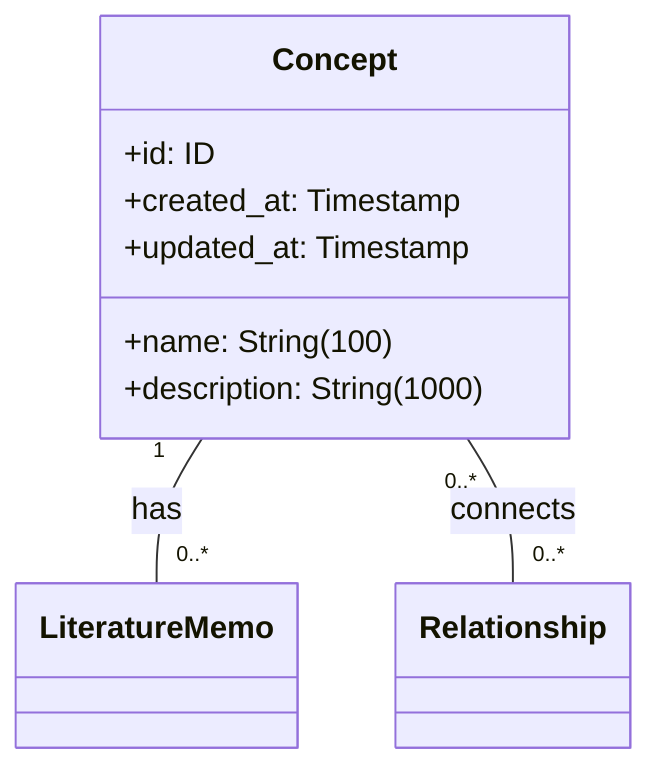

# 概念エンティティ仕様

## 前提

<!-- PREMISE_BEGIN: concept-table-schema -->

```sql
-- ============================================
-- Concept (概念) テーブル
-- ============================================
CREATE TABLE concept (
    id INTEGER PRIMARY KEY AUTOINCREMENT,
    name VARCHAR(100) NOT NULL UNIQUE CHECK(name != ''),
    description VARCHAR(1000) NOT NULL,
    created_at TIMESTAMP NOT NULL DEFAULT CURRENT_TIMESTAMP,
    updated_at TIMESTAMP NOT NULL DEFAULT CURRENT_TIMESTAMP
);

CREATE INDEX idx_concept_name ON concept(name);
CREATE INDEX idx_concept_description ON concept(description);
```

<!-- PREMISE_END: concept-table-schema -->

<!-- PREMISE_BEGIN: layered-architecture-structure -->

バックエンドは 4 層構成のレイヤードアーキテクチャを採用する。

### 設計原則

- 薄いドメイン層アプローチ: DOA とデータベース制約により、意図的に Domain 層を薄く保つ
- Active Record パターンを避ける: ビジネスロジックと DB 技術を分離
- 基本 1:1 対応: Domain エンティティと ORM エンティティは構造を揃え、変換コストを最小化
- Repository で吸収しない: ドメインロジックは Domain 層に配置し、Repository は変換のみ担当

### レイヤー構成

- **API 層**: FastAPI エンドポイント、リクエスト/レスポンスの Pydantic モデル
- **Application 層**: ユースケース実行、複数機能にまたがる処理の調整、トランザクション制御
- **Domain 層**: エンティティ(純粋な Python)、エンティティ内で閉じるビジネスロジック
- **Repository 層**: SQLAlchemy ORM、データアクセス、外部 API 通信、Domain ⇔ ORM 変換

<!-- PREMISE_END: layered-architecture-structure -->

<!-- PREMISE_BEGIN: domain-layer-responsibility -->

### Domain 層の責務

- ビジネスエンティティ定義(純粋な Python)
- エンティティ内で閉じるビジネスロジック
- データ構造から自然に導出されるロジック
- ドメインサービスはほぼ不要(DB 制約で整合性管理)

<!-- PREMISE_END: domain-layer-responsibility -->

## テーブルスキーマからエンティティ仕様への詳細化

DOA(データ指向アーキテクチャ)により、テーブルスキーマの制約をドメインエンティティ仕様に機械的に変換します。

- **変換**: テーブル構造 → ドメインエンティティ仕様
- **入力**: concept-table-schema(テーブル定義)
- **出力**: 属性仕様、ビジネスルール、関係性制約、不変条件

## 仕様詳細

<!-- GLOBAL_CONCLUSION_BEGIN: concept-entity-specification -->

### エンティティ構造



### 属性制約

- **name**: 空文字列禁止、最大 100 文字、一意
- **description**: 最大 1000 文字、必須
- **id, created_at, updated_at**: 自動設定

### 不変条件

- name は空文字列でない
- name は知識体系内で一意
- created_at と updated_at は必ず存在
- updated_at ≧ created_at

### ビジネスルール

#### 名前の一意性

同名の概念が複数存在すると、個人の理解体系が曖昧になり、文献メモや関係性の紐付けが混乱するため、一意制約を設ける。

#### 最小限の属性

概念自体はシンプルな抽象化であり、具体的な知識内容は文献メモが保持する責務である。

### 関係性制約

- **文献メモとの関係**: 1 対多、概念削除時は ON DELETE RESTRICT でアプリケーション層が制御
- **関係性との関係**: 多対多(無向グラフ)、概念削除時は ON DELETE RESTRICT でアプリケーション層が制御

<!-- GLOBAL_CONCLUSION_END: concept-entity-specification -->
