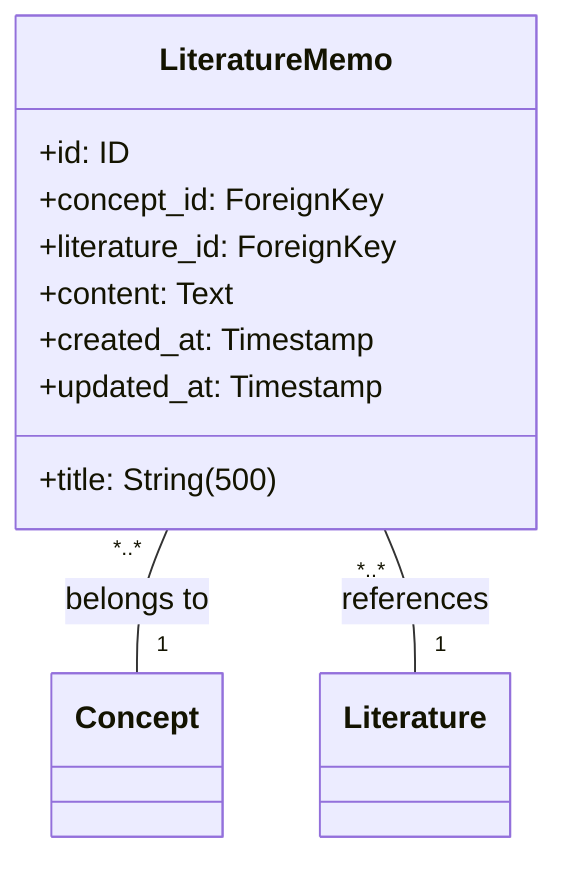

# 文献メモエンティティ仕様

## 前提

<!-- PREMISE_BEGIN: literature-memo-table-schema -->

```sql
-- ============================================
-- LiteratureMemo (文献メモ) テーブル
-- ============================================
CREATE TABLE literature_memo (
    id INTEGER PRIMARY KEY AUTOINCREMENT,
    concept_id INTEGER NOT NULL,
    literature_id INTEGER NOT NULL,
    title VARCHAR(500) NOT NULL CHECK(title != ''),
    content TEXT NOT NULL CHECK(content != ''),
    created_at TIMESTAMP NOT NULL DEFAULT CURRENT_TIMESTAMP,
    updated_at TIMESTAMP NOT NULL DEFAULT CURRENT_TIMESTAMP,
    FOREIGN KEY (concept_id) REFERENCES concept(id) ON DELETE RESTRICT,
    FOREIGN KEY (literature_id) REFERENCES literature(id) ON DELETE RESTRICT
);

CREATE INDEX idx_literature_memo_concept_id ON literature_memo(concept_id);
CREATE INDEX idx_literature_memo_literature_id ON literature_memo(literature_id);
```

<!-- PREMISE_END: literature-memo-table-schema -->

<!-- PREMISE_BEGIN: layered-architecture-structure -->

バックエンドは 4 層構成のレイヤードアーキテクチャを採用する。

### 設計原則

- 薄いドメイン層アプローチ: DOA とデータベース制約により、意図的に Domain 層を薄く保つ
- Active Record パターンを避ける: ビジネスロジックと DB 技術を分離
- 基本 1:1 対応: Domain エンティティと ORM エンティティは構造を揃え、変換コストを最小化
- Repository で吸収しない: ドメインロジックは Domain 層に配置し、Repository は変換のみ担当

### レイヤー構成

- **API 層**: FastAPI エンドポイント、リクエスト/レスポンスの Pydantic モデル
- **Application 層**: ユースケース実行、複数機能にまたがる処理の調整、トランザクション制御
- **Domain 層**: エンティティ(純粋な Python)、エンティティ内で閉じるビジネスロジック
- **Repository 層**: SQLAlchemy ORM、データアクセス、外部 API 通信、Domain ⇔ ORM 変換

<!-- PREMISE_END: layered-architecture-structure -->

<!-- PREMISE_BEGIN: domain-layer-responsibility -->

### Domain 層の責務

- ビジネスエンティティ定義(純粋な Python)
- エンティティ内で閉じるビジネスロジック
- データ構造から自然に導出されるロジック
- ドメインサービスはほぼ不要(DB 制約で整合性管理)

<!-- PREMISE_END: domain-layer-responsibility -->

## テーブルスキーマからエンティティ仕様への詳細化

DOA(データ指向アーキテクチャ)により、テーブルスキーマの制約をドメインエンティティ仕様に機械的に変換します。

- **変換**: テーブル構造 → ドメインエンティティ仕様
- **入力**: literature-memo-table-schema(テーブル定義)
- **出力**: エンティティ構造、属性制約、不変条件、ビジネスルール、関係性制約

## 仕様詳細

<!-- GLOBAL_CONCLUSION_BEGIN: literature-memo-entity-specification -->

### エンティティ構造



### 属性制約

- **title**: 空文字列禁止、最大 500 文字
- **content**: 空文字列禁止
- **concept_id**: 必須、外部キー(Concept)
- **literature_id**: 必須、外部キー(Literature)
- **id, created_at, updated_at**: 自動設定

### 不変条件

- title は空文字列でない
- content は空文字列でない
- concept_id は必ず存在し、有効な概念を参照
- literature_id は必ず存在し、有効な文献を参照
- created_at と updated_at は必ず存在
- updated_at ≧ created_at

### ビジネスルール

#### 概念との必須関連

文献メモは必ず 1 つの概念に紐づく。概念ベースの知識体系構築という中核的価値を保証するため。

#### 文献との必須関連

文献メモは必ず 1 つの文献に紐づく。外部情報を個人の理解に変換するというプロセスの透明性を保証するため。

#### 内容の個人化

LLM が生成した要約をそのまま保存するのではなく、個人が理解した形に編集することで、真の知識統合が実現される。

### 関係性制約

- **概念との関係**: 多対 1、概念削除時は ON DELETE RESTRICT でアプリケーション層が制御
- **文献との関係**: 多対 1、文献削除時は ON DELETE RESTRICT でアプリケーション層が制御

<!-- GLOBAL_CONCLUSION_END: literature-memo-entity-specification -->
