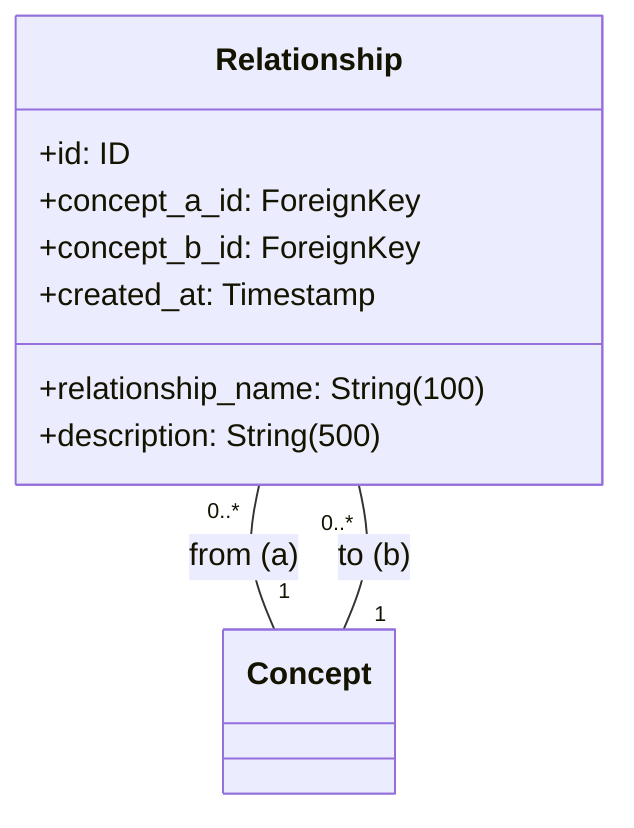

# 関係性エンティティ仕様

## 前提

<!-- PREMISE_BEGIN: relationship-table-schema -->

```sql
-- ============================================
-- Relationship (関係性) テーブル
-- ============================================
CREATE TABLE relationship (
    id INTEGER PRIMARY KEY AUTOINCREMENT,
    concept_a_id INTEGER NOT NULL,
    concept_b_id INTEGER NOT NULL,
    relationship_name VARCHAR(100) NOT NULL CHECK(relationship_name != ''),
    description VARCHAR(500) NOT NULL,
    created_at TIMESTAMP NOT NULL DEFAULT CURRENT_TIMESTAMP,
    FOREIGN KEY (concept_a_id) REFERENCES concept(id) ON DELETE RESTRICT,
    FOREIGN KEY (concept_b_id) REFERENCES concept(id) ON DELETE RESTRICT,
    CHECK (concept_a_id < concept_b_id),
    UNIQUE (concept_a_id, concept_b_id, relationship_name)
);

CREATE INDEX idx_relationship_concept_a_id ON relationship(concept_a_id);
CREATE INDEX idx_relationship_concept_b_id ON relationship(concept_b_id);
```

<!-- PREMISE_END: relationship-table-schema -->

<!-- PREMISE_BEGIN: layered-architecture-structure -->

バックエンドは 4 層構成のレイヤードアーキテクチャを採用する。

### 設計原則

- 薄いドメイン層アプローチ: DOA とデータベース制約により、意図的に Domain 層を薄く保つ
- Active Record パターンを避ける: ビジネスロジックと DB 技術を分離
- 基本 1:1 対応: Domain エンティティと ORM エンティティは構造を揃え、変換コストを最小化
- Repository で吸収しない: ドメインロジックは Domain 層に配置し、Repository は変換のみ担当

### レイヤー構成

- **API 層**: FastAPI エンドポイント、リクエスト/レスポンスの Pydantic モデル
- **Application 層**: ユースケース実行、複数機能にまたがる処理の調整、トランザクション制御
- **Domain 層**: エンティティ(純粋な Python)、エンティティ内で閉じるビジネスロジック
- **Repository 層**: SQLAlchemy ORM、データアクセス、外部 API 通信、Domain ⇔ ORM 変換

<!-- PREMISE_END: layered-architecture-structure -->

<!-- PREMISE_BEGIN: domain-layer-responsibility -->

### Domain 層の責務

- ビジネスエンティティ定義(純粋な Python)
- エンティティ内で閉じるビジネスロジック
- データ構造から自然に導出されるロジック
- ドメインサービスはほぼ不要(DB 制約で整合性管理)

<!-- PREMISE_END: domain-layer-responsibility -->

## テーブルスキーマからエンティティ仕様への詳細化

DOA(データ指向アーキテクチャ)により、テーブルスキーマの制約をドメインエンティティ仕様に機械的に変換します。

- **変換**: テーブル構造 → ドメインエンティティ仕様
- **入力**: relationship-table-schema(テーブル定義)
- **出力**: エンティティ構造、属性制約、不変条件、ビジネスルール、関係性制約

## 仕様詳細

<!-- GLOBAL_CONCLUSION_BEGIN: relationship-entity-specification -->

### エンティティ構造



### 属性制約

- **relationship_name**: 空文字列禁止、最大 100 文字
- **description**: 最大 500 文字、空文字列許容
- **concept_a_id, concept_b_id**: 必須、外部キー(Concept)、concept_a_id < concept_b_id
- **複合 UNIQUE 制約**: (concept_a_id, concept_b_id, relationship_name)
- **id, created_at**: 自動設定

### 不変条件

- relationship_name は空文字列でない
- concept_a_id < concept_b_id (無向グラフ正規化)
- concept_a_id は必ず存在し、有効な概念を参照
- concept_b_id は必ず存在し、有効な概念を参照
- (concept_a_id, concept_b_id, relationship_name) は一意
- created_at は必ず存在

### ビジネスルール

#### 無向グラフの正規化

概念 A と B の関係は一方向のみ記録される。CHECK 制約により concept_a_id < concept_b_id が保証され、重複する関係性の登録が防止される。

#### 個人的関係語彙

関係名は個人が自由に定義できる。形式的なオントロジーに縛られず、個人の理解に基づいた自然な表現を使用する。

#### 同一概念間の複数関係許可

同一の概念ペア間に複数の異なる関係性を定義できる。UNIQUE 制約により同一関係名の重複は防止しつつ、多面的な関係性の表現を可能にする。

### 関係性制約

- **概念との関係**: 多対多(無向グラフ)、概念削除時は ON DELETE RESTRICT でアプリケーション層が制御

<!-- GLOBAL_CONCLUSION_END: relationship-entity-specification -->
