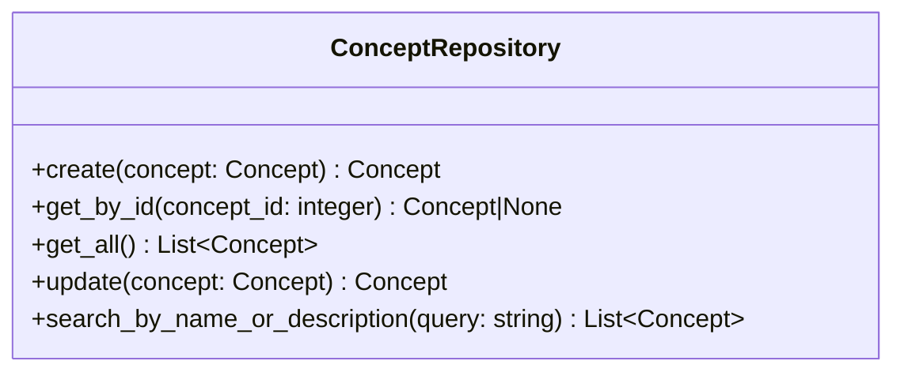

# 概念検索サービス仕様

## 前提

<!-- PREMISE_BEGIN: concept-repository-specification -->

概念 Repository 仕様として以下を定義する。

### 概念 Repository の責務

概念エンティティのデータアクセスを提供する。SQLAlchemy ORM モデルと Domain エンティティの変換、CRUD 操作、名前・説明による検索を実装する。

### 概念 Repository のインターフェース

### 概念 Repository の実装方針

- ORM モデルと Domain モデルは 1:1 対応で構造を揃える
- インデックスを活用した効率的な検索を実現する
- トランザクション境界は Application 層で制御し、Repository は単一操作のみを提供する

<!-- PREMISE_END: concept-repository-specification -->

<!-- PREMISE_BEGIN: layered-architecture-structure -->

バックエンドは 4 層構成のレイヤードアーキテクチャを採用する。

#### 設計原則

- 薄いドメイン層アプローチ: DOA とデータベース制約により、意図的に Domain 層を薄く保つ
- Active Record パターンを避ける: ビジネスロジックと DB 技術を分離
- 基本 1:1 対応: Domain エンティティと ORM エンティティは構造を揃え、変換コストを最小化
- Repository で吸収しない: ドメインロジックは Domain 層に配置し、Repository は変換のみ担当

#### レイヤー構成

- **API 層**: FastAPI エンドポイント、リクエスト/レスポンスの Pydantic モデル
- **Application 層**: ユースケース実行、複数機能にまたがる処理の調整、トランザクション制御
- **Domain 層**: エンティティ(純粋な Python)、エンティティ内で閉じるビジネスロジック
- **Repository 層**: SQLAlchemy ORM、データアクセス、外部 API 通信、Domain ⇔ ORM 変換

<!-- PREMISE_END: layered-architecture-structure -->

<!-- PREMISE_BEGIN: application-layer-responsibility -->

#### Application 層の責務

- ユースケース実装
- トランザクション制御
- 複数機能にまたがる処理の調整
- Repository 層を使った外部システム協調

<!-- PREMISE_END: application-layer-responsibility -->

## 論理

第一に、概念検索サービスは概念の検索機能を提供する Application 層のコンポーネントである。API 層から受け取った検索クエリを処理し、概念 Repository の検索機能を使用する。

第二に、概念 Repository の search_by_name_or_description メソッドを使用して、名前・説明による部分一致検索を実行する。インデックスを活用した効率的な検索を提供する。

第三に、検索クエリのバリデーションと結果の整形は Application 層で行う。空のクエリや不正な入力に対するエラーハンドリングを担当する。

## 結論

<!-- GLOBAL_CONCLUSION_BEGIN: concept-search-service-specification -->

概念検索サービス仕様として以下を定義する。

### 概念検索サービスの責務

- 概念検索に関するユースケース実装を行う。
- 検索クエリのバリデーションを行う。
- 概念 Repository を使用した検索を実行する。
- エラーハンドリングと例外処理を行う。

### 概念検索サービスのインターフェース

- `search_concepts(query: str) -> list[Concept]`: 名前・説明で概念を検索する

### 概念検索サービスの実装方針

- ステートレス実装を行う。
- リクエストスコープのライフサイクルを持つ。
- 概念 Repository への依存のみを持つ。
- 検索クエリのバリデーションを Application 層で行う。

<!-- GLOBAL_CONCLUSION_END: concept-search-service-specification -->
