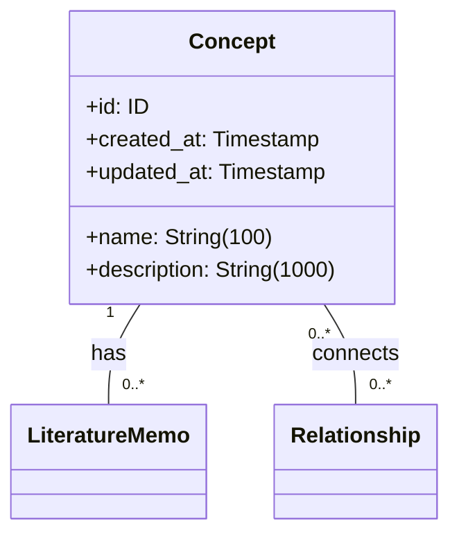
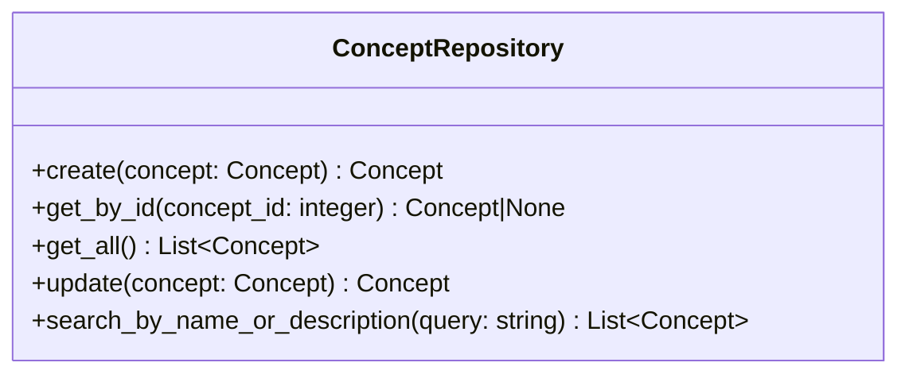

# 概念サービス仕様

## 前提

<!-- PREMISE_BEGIN: concept-entity-specification -->

### エンティティ構造

### 属性制約

- **name**: 空文字列禁止、最大 100 文字、一意
- **description**: 最大 1000 文字、必須
- **id, created_at, updated_at**: 自動設定

### 不変条件

- name は空文字列でない
- name は知識体系内で一意
- created_at と updated_at は必ず存在
- updated_at ≧ created_at

### ビジネスルール

#### 名前の一意性

同名の概念が複数存在すると、個人の理解体系が曖昧になり、文献メモや関係性の紐付けが混乱するため、一意制約を設ける。

#### 最小限の属性

概念自体はシンプルな抽象化であり、具体的な知識内容は文献メモが保持する責務である。

### 関係性制約

- **文献メモとの関係**: 1 対多、概念削除時は ON DELETE RESTRICT でアプリケーション層が制御
- **関係性との関係**: 多対多(無向グラフ)、概念削除時は ON DELETE RESTRICT でアプリケーション層が制御

<!-- PREMISE_END: concept-entity-specification -->

<!-- PREMISE_BEGIN: concept-repository-specification -->

概念 Repository 仕様として以下を定義する。

### 概念 Repository の責務

概念エンティティのデータアクセスを提供する。SQLAlchemy ORM モデルと Domain エンティティの変換、CRUD 操作、名前・説明による検索を実装する。

### 概念 Repository のインターフェース

### 概念 Repository の実装方針

- ORM モデルと Domain モデルは 1:1 対応で構造を揃える
- インデックスを活用した効率的な検索を実現する
- トランザクション境界は Application 層で制御し、Repository は単一操作のみを提供する

<!-- PREMISE_END: concept-repository-specification -->

<!-- PREMISE_BEGIN: layered-architecture-structure -->

バックエンドは 4 層構成のレイヤードアーキテクチャを採用する。

#### 設計原則

- 薄いドメイン層アプローチ: DOA とデータベース制約により、意図的に Domain 層を薄く保つ
- Active Record パターンを避ける: ビジネスロジックと DB 技術を分離
- 基本 1:1 対応: Domain エンティティと ORM エンティティは構造を揃え、変換コストを最小化
- Repository で吸収しない: ドメインロジックは Domain 層に配置し、Repository は変換のみ担当

#### レイヤー構成

- **API 層**: FastAPI エンドポイント、リクエスト/レスポンスの Pydantic モデル
- **Application 層**: ユースケース実行、複数機能にまたがる処理の調整、トランザクション制御
- **Domain 層**: エンティティ(純粋な Python)、エンティティ内で閉じるビジネスロジック
- **Repository 層**: SQLAlchemy ORM、データアクセス、外部 API 通信、Domain ⇔ ORM 変換

<!-- PREMISE_END: layered-architecture-structure -->

<!-- PREMISE_BEGIN: application-layer-responsibility -->

#### Application 層の責務

- ユースケース実装
- トランザクション制御
- 複数機能にまたがる処理の調整
- Repository 層を使った外部システム協調

<!-- PREMISE_END: application-layer-responsibility -->

## 論理

第一に、概念サービスは概念エンティティに関するユースケースを実装する Application 層のコンポーネントである。API 層から受け取ったリクエストを処理し、概念 Repository を使用してデータアクセスを行う。

第二に、Application 層の責務であるトランザクション制御を担当する。Repository は単一操作のみを提供するため、複数の Repository 操作が必要な場合のトランザクション境界はサービスが管理する。

第三に、概念に関する基本的な CRUD 操作と検索機能を提供する。概念 Repository のインターフェースを使用し、ユースケースに応じた処理フローを実装する。

第四に、エラーハンドリングと例外処理を担当する。Repository から発生する例外を適切に処理し、API 層に返すエラー情報を整形する。

## 結論

<!-- GLOBAL_CONCLUSION_BEGIN: concept-service-specification -->

概念サービス仕様として以下を定義する。

### 概念サービスの責務

- 概念に関するユースケース実装を行う。
- トランザクション制御を担当する。
- 概念 Repository を使用したデータアクセスを行う。
- エラーハンドリングと例外処理を行う。

### 概念サービスのインターフェース

- `create_concept(name: str, description: str) -> Concept`: 概念を作成する
- `get_concept(concept_id: int) -> Concept`: ID で概念を取得する
- `list_concepts() -> list[Concept]`: 全概念を取得する
- `update_concept(concept_id: int, name: str | None, description: str | None) -> Concept`: 概念を更新する
- `search_concepts(query: str) -> list[Concept]`: 名前・説明で検索する

### 概念サービスの実装方針

- ステートレス実装を行う。
- リクエストスコープのライフサイクルを持つ。
- 概念 Repository への依存のみを持つ。
- トランザクション境界を明確に管理する。

<!-- GLOBAL_CONCLUSION_END: concept-service-specification -->
