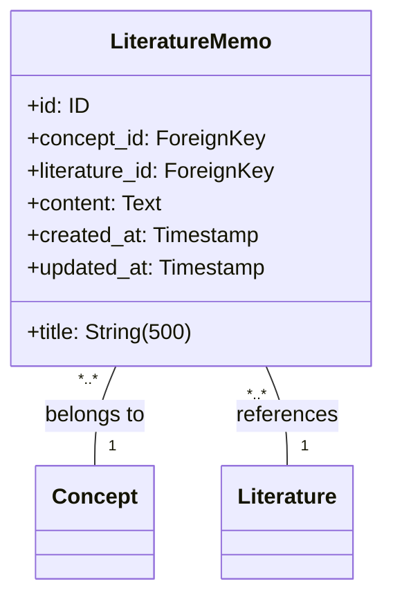
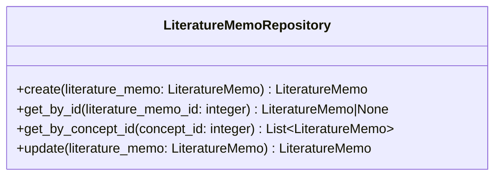

# 文献メモサービス仕様

## 前提

<!-- PREMISE_BEGIN: literature-memo-entity-specification -->

### エンティティ構造

### 属性制約

- **title**: 空文字列禁止、最大 500 文字
- **content**: 空文字列禁止
- **concept_id**: 必須、外部キー(Concept)
- **literature_id**: 必須、外部キー(Literature)
- **id, created_at, updated_at**: 自動設定

### 不変条件

- title は空文字列でない
- content は空文字列でない
- concept_id は必ず存在し、有効な概念を参照
- literature_id は必ず存在し、有効な文献を参照
- created_at と updated_at は必ず存在
- updated_at ≧ created_at

### ビジネスルール

#### 概念との必須関連

文献メモは必ず 1 つの概念に紐づく。概念ベースの知識体系構築という中核的価値を保証するため。

#### 文献との必須関連

文献メモは必ず 1 つの文献に紐づく。外部情報を個人の理解に変換するというプロセスの透明性を保証するため。

#### 内容の個人化

LLM が生成した要約をそのまま保存するのではなく、個人が理解した形に編集することで、真の知識統合が実現される。

### 関係性制約

- **概念との関係**: 多対 1、概念削除時は ON DELETE RESTRICT でアプリケーション層が制御
- **文献との関係**: 多対 1、文献削除時は ON DELETE RESTRICT でアプリケーション層が制御

<!-- PREMISE_END: literature-memo-entity-specification -->

<!-- PREMISE_BEGIN: literature-memo-repository-specification -->

文献メモ Repository 仕様として以下を定義する。

### 文献メモ Repository の責務

文献メモエンティティのデータアクセスを提供する。SQLAlchemy ORM モデルと Domain エンティティの変換、CRUD 操作、概念別一覧取得を実装する。

### 文献メモ Repository のインターフェース

### 文献メモ Repository の実装方針

- ORM モデルと Domain モデルは 1:1 対応で構造を揃える
- 外部キー参照は ID のみを保持し、関連エンティティの取得は必要に応じて別途行う
- インデックスを活用した効率的な概念別取得を実現する
- トランザクション境界は Application 層で制御し、Repository は単一操作のみを提供する

<!-- PREMISE_END: literature-memo-repository-specification -->

<!-- PREMISE_BEGIN: layered-architecture-structure -->

バックエンドは 4 層構成のレイヤードアーキテクチャを採用する。

#### 設計原則

- 薄いドメイン層アプローチ: DOA とデータベース制約により、意図的に Domain 層を薄く保つ
- Active Record パターンを避ける: ビジネスロジックと DB 技術を分離
- 基本 1:1 対応: Domain エンティティと ORM エンティティは構造を揃え、変換コストを最小化
- Repository で吸収しない: ドメインロジックは Domain 層に配置し、Repository は変換のみ担当

#### レイヤー構成

- **API 層**: FastAPI エンドポイント、リクエスト/レスポンスの Pydantic モデル
- **Application 層**: ユースケース実行、複数機能にまたがる処理の調整、トランザクション制御
- **Domain 層**: エンティティ(純粋な Python)、エンティティ内で閉じるビジネスロジック
- **Repository 層**: SQLAlchemy ORM、データアクセス、外部 API 通信、Domain ⇔ ORM 変換

<!-- PREMISE_END: layered-architecture-structure -->

<!-- PREMISE_BEGIN: application-layer-responsibility -->

#### Application 層の責務

- ユースケース実装
- トランザクション制御
- 複数機能にまたがる処理の調整
- Repository 層を使った外部システム協調

<!-- PREMISE_END: application-layer-responsibility -->

## 論理

第一に、文献メモサービスは文献メモエンティティに関するユースケースを実装する Application 層のコンポーネントである。API 層から受け取ったリクエストを処理し、文献メモ Repository を使用してデータアクセスを行う。

第二に、文献メモの作成では概念 ID と文献 ID の外部キー制約を満たす必要がある。Application 層でこれらの存在確認を行い、データ整合性を保証する。

第三に、概念別の文献メモ一覧取得では、文献メモ Repository のインデックスを活用した効率的な検索を提供する。トランザクション制御とエラーハンドリングは Application 層の責務である。

第四に、文献メモの更新では、LLM が生成した要約を個人の理解に基づいて編集するプロセスを支援する。内容の個人化により真の知識統合を実現する。

## 結論

<!-- GLOBAL_CONCLUSION_BEGIN: literature-memo-service-specification -->

文献メモサービス仕様として以下を定義する。

### 文献メモサービスの責務

- 文献メモに関するユースケース実装を行う。
- 外部キー制約の整合性確認を行う。
- トランザクション制御を担当する。
- 文献メモ Repository を使用したデータアクセスを行う。
- エラーハンドリングと例外処理を行う。

### 文献メモサービスのインターフェース

- `create_literature_memo(concept_id: int, literature_id: int, title: str, content: str) -> LiteratureMemo`: 文献メモを作成する
- `get_literature_memo(literature_memo_id: int) -> LiteratureMemo`: ID で文献メモを取得する
- `list_literature_memos_by_concept(concept_id: int) -> list[LiteratureMemo]`: 概念別文献メモ一覧を取得する
- `update_literature_memo(literature_memo_id: int, title: str | None, content: str | None) -> LiteratureMemo`: 文献メモを更新する

### 文献メモサービスの実装方針

- ステートレス実装を行う。
- リクエストスコープのライフサイクルを持つ。
- 文献メモ Repository への依存のみを持つ。
- 外部キー制約の整合性を Application 層で確認する。
- トランザクション境界を明確に管理する。

<!-- GLOBAL_CONCLUSION_END: literature-memo-service-specification -->
