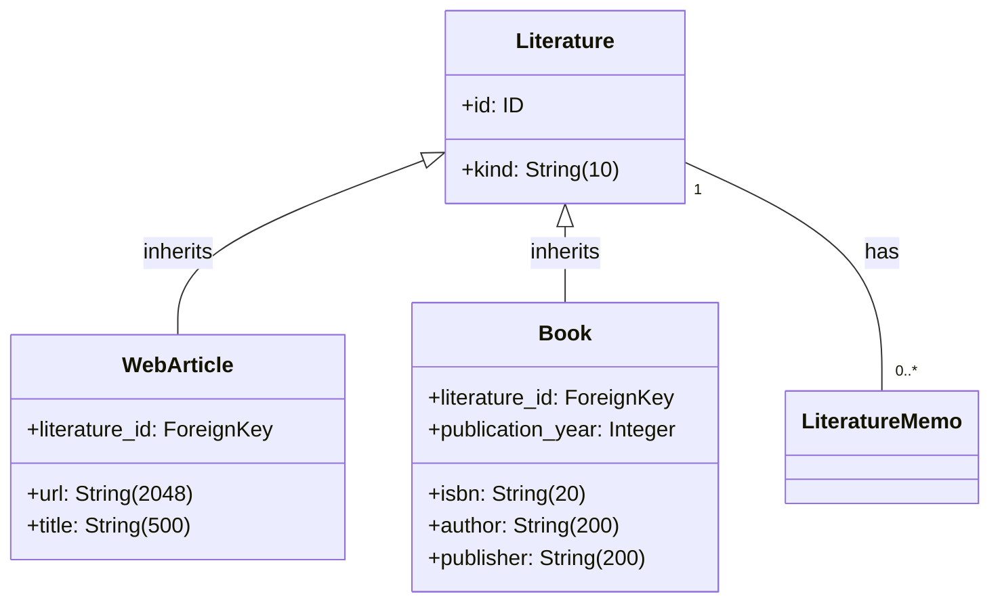
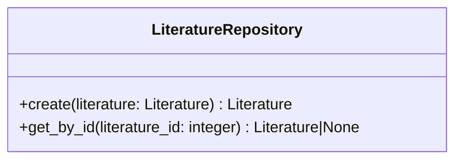

# 文献サービス仕様

## 前提

<!-- PREMISE_BEGIN: literature-entity-specification -->

### エンティティ構造

### 属性制約

**Literature (基底)**:

- **kind**: 'web' または 'book'、必須
- **id**: 自動設定

**WebArticle (派生)**:

- **url**: 空文字列禁止、最大 2048 文字
- **title**: 空文字列禁止、最大 500 文字
- **literature_id**: PRIMARY KEY、外部キー(Literature)

**Book (派生)**:

- **isbn**: 空文字列禁止、最大 20 文字、一意
- **author**: 空文字列禁止、最大 200 文字
- **publisher**: 空文字列禁止、最大 200 文字
- **publication_year**: 必須
- **literature_id**: PRIMARY KEY、外部キー(Literature)

### 不変条件

- kind は 'web' または 'book'
- kind = 'web' なら web_article レコードが存在
- kind = 'book' なら book レコードが存在
- WebArticle: url と title は空文字列でない
- Book: isbn, author, publisher は空文字列でない
- Book: isbn は一意

### ビジネスルール

#### 継承テーブル構造

CTI(Class Table Inheritance)により、基底テーブル(Literature)と派生テーブル(WebArticle/Book)に分離。型安全性と拡張性を確保。

#### 書誌情報のシンプル性

文献の内容そのものは保持せず、文献メモが個人の理解として保持する責務である。

#### 複数観点からの読み直し

同一文献を複数の概念の観点で読み直すことを許可する。一つの文献から複数の文献メモが生成され、多面的な知識統合が実現される。

### 関係性制約

- **文献メモとの関係**: 1 対多、文献削除時は ON DELETE RESTRICT でアプリケーション層が制御

<!-- PREMISE_END: literature-entity-specification -->

<!-- PREMISE_BEGIN: literature-repository-specification -->

文献 Repository 仕様として以下を定義する。

### 文献 Repository の責務

文献エンティティのデータアクセスを提供する。SQLAlchemy ORM モデルと Domain エンティティの変換、CRUD 操作を実装する。

### 文献 Repository のインターフェース

### 文献 Repository の実装方針

- ORM モデルと Domain モデルは 1:1 対応で構造を揃える
- 文献の作成と読み取りのみを提供する(更新・削除は優先度低)
- トランザクション境界は Application 層で制御し、Repository は単一操作のみを提供する

<!-- PREMISE_END: literature-repository-specification -->

<!-- PREMISE_BEGIN: layered-architecture-structure -->

バックエンドは 4 層構成のレイヤードアーキテクチャを採用する。

#### 設計原則

- 薄いドメイン層アプローチ: DOA とデータベース制約により、意図的に Domain 層を薄く保つ
- Active Record パターンを避ける: ビジネスロジックと DB 技術を分離
- 基本 1:1 対応: Domain エンティティと ORM エンティティは構造を揃え、変換コストを最小化
- Repository で吸収しない: ドメインロジックは Domain 層に配置し、Repository は変換のみ担当

#### レイヤー構成

- **API 層**: FastAPI エンドポイント、リクエスト/レスポンスの Pydantic モデル
- **Application 層**: ユースケース実行、複数機能にまたがる処理の調整、トランザクション制御
- **Domain 層**: エンティティ(純粋な Python)、エンティティ内で閉じるビジネスロジック
- **Repository 層**: SQLAlchemy ORM、データアクセス、外部 API 通信、Domain ⇔ ORM 変換

<!-- PREMISE_END: layered-architecture-structure -->

<!-- PREMISE_BEGIN: application-layer-responsibility -->

#### Application 層の責務

- ユースケース実装
- トランザクション制御
- 複数機能にまたがる処理の調整
- Repository 層を使った外部システム協調

<!-- PREMISE_END: application-layer-responsibility -->

## 論理

第一に、文献サービスは文献エンティティに関するユースケースを実装する Application 層のコンポーネントである。API 層から受け取ったリクエストを処理し、文献 Repository を使用してデータアクセスを行う。

第二に、文献の作成では Web 記事または書籍の書誌情報を登録する。文献の内容そのものは保持せず、文献メモが個人の理解として保持する責務分担を実現する。

第三に、同一文献を複数の概念の観点で読み直すことを許可する。複数の文献メモが同一の文献 ID を参照することにより、多面的な知識統合を実現する。

第四に、文献の更新・削除は優先度が低いため、作成と読み取りのみを提供する。トランザクション制御とエラーハンドリングは Application 層の責務である。

## 結論

<!-- GLOBAL_CONCLUSION_BEGIN: literature-service-specification -->

文献サービス仕様として以下を定義する。

### 文献サービスの責務

- 文献に関するユースケース実装を行う。
- トランザクション制御を担当する。
- 文献 Repository を使用したデータアクセスを行う。
- エラーハンドリングと例外処理を行う。

### 文献サービスのインターフェース

- `create_web_article(url: str, title: str) -> Literature`: Web 記事を作成する
- `create_book(isbn: str, author: str, publisher: str, publication_year: int) -> Literature`: 書籍を作成する
- `get_literature(literature_id: int) -> Literature`: ID で文献を取得する

### 文献サービスの実装方針

- ステートレス実装を行う。
- リクエストスコープのライフサイクルを持つ。
- 文献 Repository への依存のみを持つ。
- 作成と読み取りのみを提供する。
- トランザクション境界を明確に管理する。

<!-- GLOBAL_CONCLUSION_END: literature-service-specification -->
