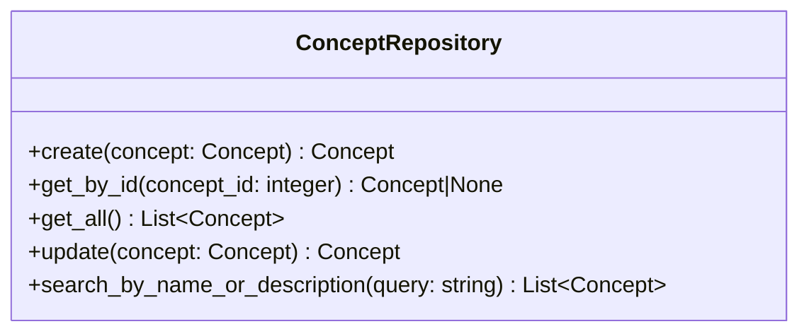

# 質問から概念候補提示サービス仕様

## 前提

<!-- PREMISE_BEGIN: concept-repository-specification -->

概念 Repository 仕様として以下を定義する。

### 概念 Repository の責務

概念エンティティのデータアクセスを提供する。SQLAlchemy ORM モデルと Domain エンティティの変換、CRUD 操作、名前・説明による検索を実装する。

### 概念 Repository のインターフェース

### 概念 Repository の実装方針

- ORM モデルと Domain モデルは 1:1 対応で構造を揃える
- インデックスを活用した効率的な検索を実現する
- トランザクション境界は Application 層で制御し、Repository は単一操作のみを提供する

<!-- PREMISE_END: concept-repository-specification -->

<!-- PREMISE_BEGIN: layered-architecture-structure -->

バックエンドは 4 層構成のレイヤードアーキテクチャを採用する。

#### 設計原則

- 薄いドメイン層アプローチ: DOA とデータベース制約により、意図的に Domain 層を薄く保つ
- Active Record パターンを避ける: ビジネスロジックと DB 技術を分離
- 基本 1:1 対応: Domain エンティティと ORM エンティティは構造を揃え、変換コストを最小化
- Repository で吸収しない: ドメインロジックは Domain 層に配置し、Repository は変換のみ担当

#### レイヤー構成

- **API 層**: FastAPI エンドポイント、リクエスト/レスポンスの Pydantic モデル
- **Application 層**: ユースケース実行、複数機能にまたがる処理の調整、トランザクション制御
- **Domain 層**: エンティティ(純粋な Python)、エンティティ内で閉じるビジネスロジック
- **Repository 層**: SQLAlchemy ORM、データアクセス、外部 API 通信、Domain ⇔ ORM 変換

<!-- PREMISE_END: layered-architecture-structure -->

<!-- PREMISE_BEGIN: application-layer-responsibility -->

#### Application 層の責務

- ユースケース実装
- トランザクション制御
- 複数機能にまたがる処理の調整
- Repository 層を使った外部システム協調

<!-- PREMISE_END: application-layer-responsibility -->

## 論理

第一に、質問から概念候補提示サービスは、ユーザーの質問内容から関連する概念を提示する Application 層のコンポーネントである。LLM を活用して質問内容を分析し、既存の概念との関連性を判定する。

第二に、概念 Repository の get_all メソッドを使用して、全概念を取得する。取得した概念リストと質問内容を LLM に渡し、関連性のある概念を抽出する。

第三に、LLM は質問内容と各概念の説明を分析し、関連性のある概念とその理由を返す。Application 層で LLM の応答を解析し、概念候補リストを生成する。

第四に、LLM API の一時的な障害に対するエラーハンドリングを担当する。リトライ処理やタイムアウト処理は Application 層で実装する。

## 結論

<!-- GLOBAL_CONCLUSION_BEGIN: question-to-concepts-service-specification -->

質問から概念候補提示サービス仕様として以下を定義する。

### 質問から概念候補提示サービスの責務

- 質問内容から概念候補を提示するユースケース実装を行う。
- 概念 Repository を使用して全概念を取得する。
- LLM Repository を使用して質問内容を分析する。
- LLM の応答を解析して概念候補リストを生成する。
- エラーハンドリングと例外処理を行う。

### 質問から概念候補提示サービスのインターフェース

- `suggest_concepts_from_question(question: str) -> list[ConceptSuggestion]`: 質問から概念候補を提示する

### 質問から概念候補提示サービスの実装方針

- ステートレス実装を行う。
- リクエストスコープのライフサイクルを持つ。
- 概念 Repository と LLM Repository への依存を持つ。
- LLM API の障害に対するエラーハンドリングを実装する。

<!-- GLOBAL_CONCLUSION_END: question-to-concepts-service-specification -->
