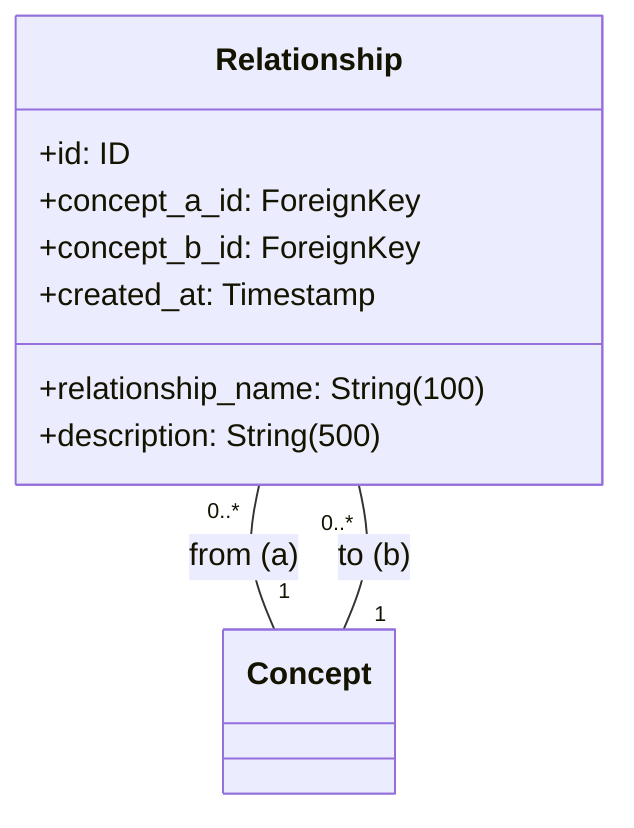
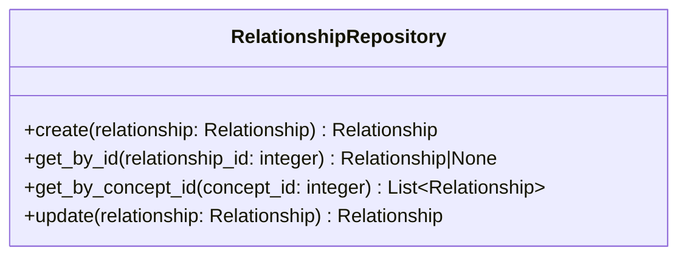

# 関係性サービス仕様

## 前提

<!-- PREMISE_BEGIN: relationship-entity-specification -->

### エンティティ構造

### 属性制約

- **relationship_name**: 空文字列禁止、最大 100 文字
- **description**: 最大 500 文字、空文字列許容
- **concept_a_id, concept_b_id**: 必須、外部キー(Concept)、concept_a_id < concept_b_id
- **複合 UNIQUE 制約**: (concept_a_id, concept_b_id, relationship_name)
- **id, created_at**: 自動設定

### 不変条件

- relationship_name は空文字列でない
- concept_a_id < concept_b_id (無向グラフ正規化)
- concept_a_id は必ず存在し、有効な概念を参照
- concept_b_id は必ず存在し、有効な概念を参照
- (concept_a_id, concept_b_id, relationship_name) は一意
- created_at は必ず存在

### ビジネスルール

#### 無向グラフの正規化

概念 A と B の関係は一方向のみ記録される。CHECK 制約により concept_a_id < concept_b_id が保証され、重複する関係性の登録が防止される。

#### 個人的関係語彙

関係名は個人が自由に定義できる。形式的なオントロジーに縛られず、個人の理解に基づいた自然な表現を使用する。

#### 同一概念間の複数関係許可

同一の概念ペア間に複数の異なる関係性を定義できる。UNIQUE 制約により同一関係名の重複は防止しつつ、多面的な関係性の表現を可能にする。

### 関係性制約

- **概念との関係**: 多対多(無向グラフ)、概念削除時は ON DELETE RESTRICT でアプリケーション層が制御

<!-- PREMISE_END: relationship-entity-specification -->

<!-- PREMISE_BEGIN: relationship-repository-specification -->

関係性 Repository 仕様として以下を定義する。

### 関係性 Repository の責務

関係性エンティティのデータアクセスを提供する。SQLAlchemy ORM モデルと Domain エンティティの変換、CRUD 操作、概念 ID による関係性取得を実装する。

### 関係性 Repository のインターフェース

### 関係性 Repository の実装方針

- ORM モデルと Domain モデルは 1:1 対応で構造を揃える
- 無向グラフの正規化制約(concept_a_id < concept_b_id)を維持する
- 概念 ID による取得では concept_a_id と concept_b_id の両方を検索する
- トランザクション境界は Application 層で制御し、Repository は単一操作のみを提供する

<!-- PREMISE_END: relationship-repository-specification -->

<!-- PREMISE_BEGIN: layered-architecture-structure -->

バックエンドは 4 層構成のレイヤードアーキテクチャを採用する。

#### 設計原則

- 薄いドメイン層アプローチ: DOA とデータベース制約により、意図的に Domain 層を薄く保つ
- Active Record パターンを避ける: ビジネスロジックと DB 技術を分離
- 基本 1:1 対応: Domain エンティティと ORM エンティティは構造を揃え、変換コストを最小化
- Repository で吸収しない: ドメインロジックは Domain 層に配置し、Repository は変換のみ担当

#### レイヤー構成

- **API 層**: FastAPI エンドポイント、リクエスト/レスポンスの Pydantic モデル
- **Application 層**: ユースケース実行、複数機能にまたがる処理の調整、トランザクション制御
- **Domain 層**: エンティティ(純粋な Python)、エンティティ内で閉じるビジネスロジック
- **Repository 層**: SQLAlchemy ORM、データアクセス、外部 API 通信、Domain ⇔ ORM 変換

<!-- PREMISE_END: layered-architecture-structure -->

<!-- PREMISE_BEGIN: application-layer-responsibility -->

#### Application 層の責務

- ユースケース実装
- トランザクション制御
- 複数機能にまたがる処理の調整
- Repository 層を使った外部システム協調

<!-- PREMISE_END: application-layer-responsibility -->

## 論理

第一に、関係性サービスは関係性エンティティに関するユースケースを実装する Application 層のコンポーネントである。API 層から受け取ったリクエストを処理し、関係性 Repository を使用してデータアクセスを行う。

第二に、関係性の作成では無向グラフの正規化制約(concept_a_id < concept_b_id)を維持する必要がある。Application 層で concept_a_id と concept_b_id の大小関係を確認し、必要に応じて入れ替えを行う。

第三に、概念 ID による関係性取得では、無向グラフの特性により concept_a_id と concept_b_id の両方を検索する。関係性 Repository のインデックスを活用した効率的な検索を提供する。

第四に、個人的な関係語彙による柔軟な関係定義を支援する。形式的なオントロジーに縛られず、個人の理解に基づいた自然な表現を許可する。

## 結論

<!-- GLOBAL_CONCLUSION_BEGIN: relationship-service-specification -->

関係性サービス仕様として以下を定義する。

### 関係性サービスの責務

- 関係性に関するユースケース実装を行う。
- 無向グラフの正規化制約を維持する。
- トランザクション制御を担当する。
- 関係性 Repository を使用したデータアクセスを行う。
- エラーハンドリングと例外処理を行う。

### 関係性サービスのインターフェース

- `create_relationship(concept_a_id: int, concept_b_id: int, relationship_name: str, description: str) -> Relationship`: 関係性を作成する
- `get_relationship(relationship_id: int) -> Relationship`: ID で関係性を取得する
- `list_relationships_by_concept(concept_id: int) -> list[Relationship]`: 概念別関係性一覧を取得する
- `update_relationship(relationship_id: int, relationship_name: str | None, description: str | None) -> Relationship`: 関係性を更新する

### 関係性サービスの実装方針

- ステートレス実装を行う。
- リクエストスコープのライフサイクルを持つ。
- 関係性 Repository への依存のみを持つ。
- 無向グラフの正規化制約を Application 層で維持する。
- トランザクション境界を明確に管理する。

<!-- GLOBAL_CONCLUSION_END: relationship-service-specification -->
