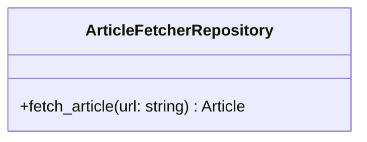

# 記事取得 Repository 仕様

## 前提

<!-- PREMISE_BEGIN: layered-architecture-structure -->

バックエンドは 4 層構成のレイヤードアーキテクチャを採用する。

### 設計原則

- 薄いドメイン層アプローチ: DOA とデータベース制約により、意図的に Domain 層を薄く保つ
- Active Record パターンを避ける: ビジネスロジックと DB 技術を分離
- 基本 1:1 対応: Domain エンティティと ORM エンティティは構造を揃え、変換コストを最小化
- Repository で吸収しない: ドメインロジックは Domain 層に配置し、Repository は変換のみ担当

### レイヤー構成

- **API 層**: FastAPI エンドポイント、リクエスト/レスポンスの Pydantic モデル
- **Application 層**: ユースケース実行、複数機能にまたがる処理の調整、トランザクション制御
- **Domain 層**: エンティティ(純粋な Python)、エンティティ内で閉じるビジネスロジック
- **Repository 層**: SQLAlchemy ORM、データアクセス、外部 API 通信、Domain ⇔ ORM 変換

<!-- PREMISE_END: layered-architecture-structure -->

<!-- PREMISE_BEGIN: repository-layer-responsibility -->

### Repository 層の責務

- SQLAlchemy ORM 定義(テーブル構造)
- データベースアクセス
- 外部 API 通信(LLM、記事取得)
- Domain エンティティ ⇔ ORM エンティティ変換
- クエリ実行、トランザクション境界

<!-- PREMISE_END: repository-layer-responsibility -->

## 論理

第一に、記事取得 Repository は Web 記事の取得を担当する Repository 層のコンポーネントである。指定された URL から記事の HTML を取得し、本文テキストを抽出して Application 層に返す。

第二に、HTML からの本文抽出にはヒューリスティックな手法またはサードパーティライブラリを使用する。記事取得の実装詳細を Repository で吸収し、Application 層は URL とテキストのみを扱う。

第三に、HTTP リクエストのタイムアウト処理とリトライ処理を実装する。接続エラーやタイムアウトに対して適切なエラーハンドリングを行う。

第四に、適切な User-Agent を設定する。アクセス元を識別できるようにし、デフォルトの User-Agent によるブロックを回避する。

## 結論

<!-- GLOBAL_CONCLUSION_BEGIN: article-fetcher-repository-specification -->

記事取得 Repository 仕様として以下を定義する。

### 記事取得 Repository の責務

- 指定 URL から Web 記事を取得する。
- HTML から本文テキストを抽出する。
- タイムアウト処理とリトライ処理を実装する。
- 適切な User-Agent を設定する。

### 記事取得 Repository のインターフェース

### 記事取得 Repository の実装方針

- HTML 取得と本文抽出の実装詳細を Application 層から隠蔽する。
- タイムアウトとリトライを実装する。
- 適切な User-Agent を設定する。

<!-- GLOBAL_CONCLUSION_END: article-fetcher-repository-specification -->
