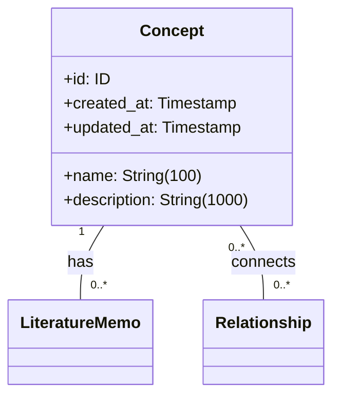
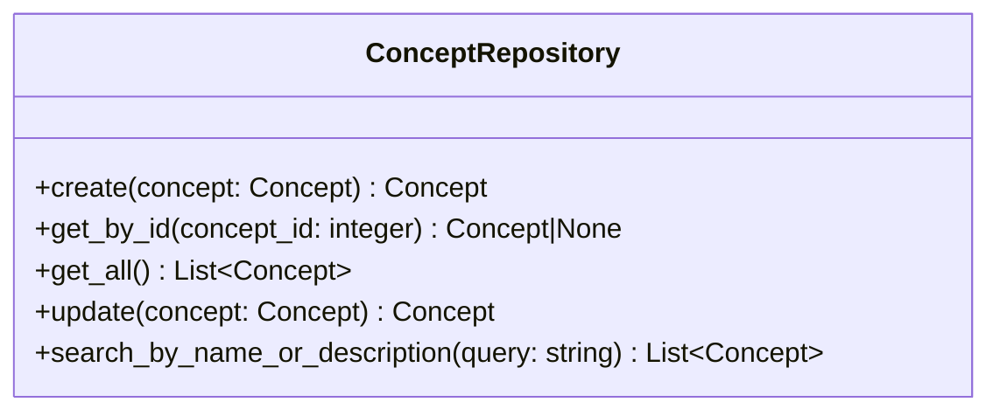

# 概念 Repository 仕様

## 前提

<!-- PREMISE_BEGIN: concept-entity-specification -->

### エンティティ構造



### 属性制約

- **name**: 空文字列禁止、最大 100 文字、一意
- **description**: 最大 1000 文字、必須
- **id, created_at, updated_at**: 自動設定

### 不変条件

- name は空文字列でない
- name は知識体系内で一意
- created_at と updated_at は必ず存在
- updated_at ≧ created_at

### ビジネスルール

#### 名前の一意性

同名の概念が複数存在すると、個人の理解体系が曖昧になり、文献メモや関係性の紐付けが混乱するため、一意制約を設ける。

#### 最小限の属性

概念自体はシンプルな抽象化であり、具体的な知識内容は文献メモが保持する責務である。

### 関係性制約

- **文献メモとの関係**: 1 対多、概念削除時は ON DELETE RESTRICT でアプリケーション層が制御
- **関係性との関係**: 多対多(無向グラフ)、概念削除時は ON DELETE RESTRICT でアプリケーション層が制御

<!-- PREMISE_END: concept-entity-specification -->

<!-- PREMISE_BEGIN: concept-table-schema -->

```sql
-- ============================================
-- Concept (概念) テーブル
-- ============================================
CREATE TABLE concept (
    id INTEGER PRIMARY KEY AUTOINCREMENT,
    name VARCHAR(100) NOT NULL UNIQUE CHECK(name != ''),
    description VARCHAR(1000) NOT NULL,
    created_at TIMESTAMP NOT NULL DEFAULT CURRENT_TIMESTAMP,
    updated_at TIMESTAMP NOT NULL DEFAULT CURRENT_TIMESTAMP
);

CREATE INDEX idx_concept_name ON concept(name);
CREATE INDEX idx_concept_description ON concept(description);
```

<!-- PREMISE_END: concept-table-schema -->

<!-- PREMISE_BEGIN: layered-architecture-structure -->

バックエンドは 4 層構成のレイヤードアーキテクチャを採用する。

### 設計原則

- 薄いドメイン層アプローチ: DOA とデータベース制約により、意図的に Domain 層を薄く保つ
- Active Record パターンを避ける: ビジネスロジックと DB 技術を分離
- 基本 1:1 対応: Domain エンティティと ORM エンティティは構造を揃え、変換コストを最小化
- Repository で吸収しない: ドメインロジックは Domain 層に配置し、Repository は変換のみ担当

### レイヤー構成

- **API 層**: FastAPI エンドポイント、リクエスト/レスポンスの Pydantic モデル
- **Application 層**: ユースケース実行、複数機能にまたがる処理の調整、トランザクション制御
- **Domain 層**: エンティティ(純粋な Python)、エンティティ内で閉じるビジネスロジック
- **Repository 層**: SQLAlchemy ORM、データアクセス、外部 API 通信、Domain ⇔ ORM 変換

<!-- PREMISE_END: layered-architecture-structure -->

<!-- PREMISE_BEGIN: repository-layer-responsibility -->

### Repository 層の責務

- SQLAlchemy ORM 定義(テーブル構造)
- データベースアクセス
- 外部 API 通信(LLM、記事取得)
- Domain エンティティ ⇔ ORM エンティティ変換
- クエリ実行、トランザクション境界

<!-- PREMISE_END: repository-layer-responsibility -->

## 論理

第一に、概念エンティティ仕様で定義された構造(id, name, description, created_at, updated_at)と制約(name の一意性、空文字列禁止)を、Repository 層で ORM モデルとして実装する必要がある。レイヤードアーキテクチャの原則により、Repository は Domain エンティティと ORM エンティティの変換を担当する。

第二に、概念テーブルスキーマで定義されたインデックス(idx_concept_name, idx_concept_description)は、名前・説明による検索を想定している。Application 層がこれらの検索機能を必要とするため、Repository はインデックスを活用した効率的な検索メソッドを提供する必要がある。

第三に、基本 1:1 対応の設計原則により、Domain エンティティと ORM エンティティは構造を揃える。属性名、型、構造を一致させることで、変換コストを最小化し、保守性を高める。

第四に、Repository で吸収しない原則により、ドメインロジックは Domain 層に配置する。Repository はデータアクセスと変換のみを担当し、CRUD 操作と検索クエリの実行に責務を限定する。トランザクション境界は Application 層で制御する。

## 結論

<!-- GLOBAL_CONCLUSION_BEGIN: concept-repository-specification -->

概念 Repository 仕様として以下を定義する。

### 概念 Repository の責務

概念エンティティのデータアクセスを提供する。SQLAlchemy ORM モデルと Domain エンティティの変換、CRUD 操作、名前・説明による検索を実装する。

### 概念 Repository のインターフェース



### 概念 Repository の実装方針

- ORM モデルと Domain モデルは 1:1 対応で構造を揃える
- インデックスを活用した効率的な検索を実現する
- トランザクション境界は Application 層で制御し、Repository は単一操作のみを提供する

<!-- GLOBAL_CONCLUSION_END: concept-repository-specification -->
