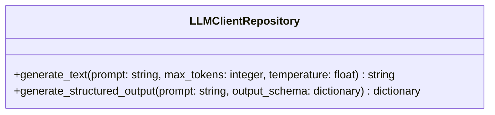

# LLM クライアント Repository 仕様

## 前提

<!-- PREMISE_BEGIN: layered-architecture-structure -->

バックエンドは 4 層構成のレイヤードアーキテクチャを採用する。

### 設計原則

- 薄いドメイン層アプローチ: DOA とデータベース制約により、意図的に Domain 層を薄く保つ
- Active Record パターンを避ける: ビジネスロジックと DB 技術を分離
- 基本 1:1 対応: Domain エンティティと ORM エンティティは構造を揃え、変換コストを最小化
- Repository で吸収しない: ドメインロジックは Domain 層に配置し、Repository は変換のみ担当

### レイヤー構成

- **API 層**: FastAPI エンドポイント、リクエスト/レスポンスの Pydantic モデル
- **Application 層**: ユースケース実行、複数機能にまたがる処理の調整、トランザクション制御
- **Domain 層**: エンティティ(純粋な Python)、エンティティ内で閉じるビジネスロジック
- **Repository 層**: SQLAlchemy ORM、データアクセス、外部 API 通信、Domain ⇔ ORM 変換

<!-- PREMISE_END: layered-architecture-structure -->

<!-- PREMISE_BEGIN: repository-layer-responsibility -->

### Repository 層の責務

- SQLAlchemy ORM 定義(テーブル構造)
- データベースアクセス
- 外部 API 通信(LLM、記事取得)
- Domain エンティティ ⇔ ORM エンティティ変換
- クエリ実行、トランザクション境界

<!-- PREMISE_END: repository-layer-responsibility -->

## 論理

第一に、LLM クライアント Repository は外部 LLM API との通信を担当する Repository 層のコンポーネントである。OpenAI API や Anthropic API などの外部 LLM サービスとの HTTP 通信を抽象化し、Application 層に統一的なインターフェースを提供する。

第二に、LLM API のリクエスト/レスポンス形式を内部データ構造に変換する。API 固有のパラメータや応答形式を Repository で吸収し、Application 層は LLM の実装詳細を意識せずに利用できる。

第三に、LLM API の一時的な障害に対するリトライ処理とタイムアウト処理を実装する。API の利用制限(rate limit)に対応し、適切なバックオフ戦略を適用する。

第四に、プロンプトテンプレートの管理は Application 層の責務とし、Repository は受け取ったプロンプトをそのまま LLM API に送信する。プロンプトの構築ロジックを Repository に含めない。

## 結論

<!-- GLOBAL_CONCLUSION_BEGIN: llm-client-repository-specification -->

LLM クライアント Repository 仕様として以下を定義する。

### LLM クライアント Repository の責務

- 外部 LLM API との HTTP 通信を提供する。
- LLM API のリクエスト/レスポンス形式を内部データ構造に変換する。
- リトライ処理とタイムアウト処理を実装する。
- API の利用制限に対応する。

### LLM クライアント Repository のインターフェース

### LLM クライアント Repository の実装方針

- LLM API の実装詳細を Application 層から隠蔽する。
- プロンプトテンプレートの管理は Application 層の責務とする。
- リトライとバックオフ戦略を実装する。
- タイムアウト処理を実装する。
- API の利用制限を考慮した実装を行う。

<!-- GLOBAL_CONCLUSION_END: llm-client-repository-specification -->
