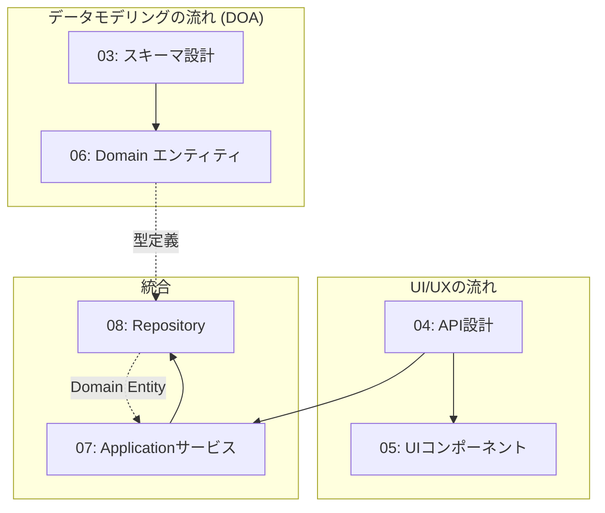

# 25-implementation-contracts - 実装契約系

## 概要

C4 モデルに基づき、システム実装における各レベルの契約を定義します。What 系で決定された設計判断を具体的な実装契約に落とし込み、設計の論理的根拠と実装の橋渡しを行います。

## 設計アプローチ

実装契約は一直線のウォーターフォールではなく、**並行する複数の流れ**で進める。

### なぜ並行開発が必要か

データモデリング(DOA)と UI/UX 設計は、それぞれ異なる関心事から出発する。データモデルは「何を保存するか」から始まり、UI/UX は「利用者が何をしたいか」から始まる。これらを一直線に並べると、どちらかが他方に従属する形になり、本来の設計意図が歪む。

### 2 つの並行する流れ

**データモデリングの流れ(DOA):**
スキーマ設計(03) → Domain エンティティ(06) と進み、データ構造を確定させる。

**UI/UX の流れ:**
API 設計(04) → UI コンポーネント(05) と進み、利用者の操作を確定させる。

### Application サービスでの統合

Application サービス(07)で両者を統合する。ここで初めて「データ側の制約」と「UI 側の要求」が出会い、矛盾を解消する。この統合結果から Repository(08)のインターフェースが決まる。

## ディレクトリ構成

### Container レベル契約

実行可能単位レベルの大きな構造契約を定義します。

- [フロントエンドパッケージ設計](01-frontend-container/README.md)
- [バックエンドモジュール設計](02-backend-container/README.md)
- [スキーマ設計](03-database-container/README.md)

### Component レベル契約

コンポーネント間の詳細な契約を定義します。

#### データモデリングの流れ (DOA)

- [Domain エンティティ仕様](06-domain-entities/README.md) - スキーマ(03)から Domain エンティティを導出

#### UI/UX の流れ

- [API 設計仕様](04-api-specifications/README.md) - UI/UX 要求からエンドポイント設計
- [UI コンポーネント仕様](05-ui-components/README.md) - API 仕様から画面コンポーネントを設計

#### Application サービスと Repository

- [Application サービス仕様](07-application-services/README.md) - ユースケース実装、データ側と UI 側を統合
- [Repository 仕様](08-repository-components/README.md) - Application サービスの要求からデータアクセスを導出

### システムレベル契約

Container と Component を超えたシステム全体の横断的な契約を定義します。

- [環境設定・デプロイ仕様](09-deployment/README.md)

## 結論

C4 モデルの Container と Component レベルで実装契約を階層的に整理し、What 系の設計判断を具体的な実装仕様に変換します。さらに、システムレベルの横断的な契約として環境設定とデプロイメントの仕様を定義します。
