<!-- markdownlint-disable MD024 -->

# UI コンポーネント契約統合

## 概要

C4 モデルの Component レベルで定義された UI コンポーネント仕様を統合する。CogitoWeave システムにおける 15 の UI 要素の完全な実装契約定義を提供し、フロントエンド実装の詳細仕様を明文化する。

## テキスト入力コンポーネント

### URL 入力フィールド

<!-- REFERENCE_BEGIN: url-input-field-implementation -->

## データフロー

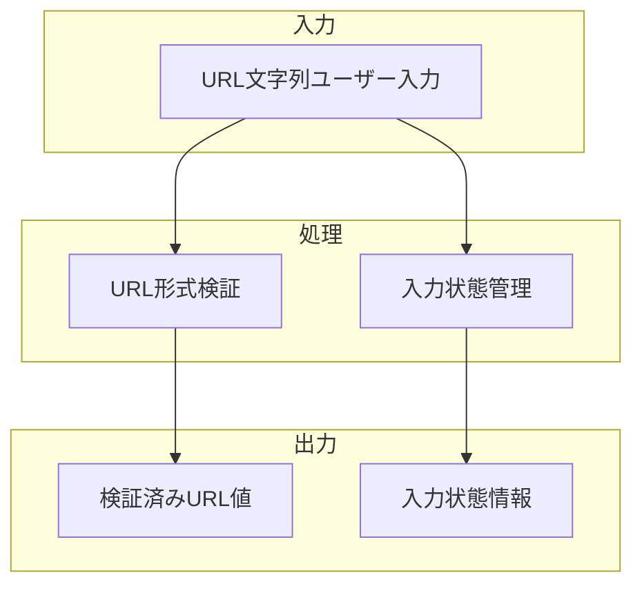

## 入力

### URL 文字列

- ユーザーが入力する URL 文字列を受け取る
  - 外部記事を取得するための基本情報として必要なため

## 処理

### URL 形式検証

- 入力された URL 文字列の形式妥当性を検証する
  - 無効な URL による後続処理のエラーを防ぐため
- http/https スキームの確認を実行する
  - セキュリティ制約に適合する URL のみを受け入れるため

### 入力状態管理

- 空/入力中/検証済み/エラーの状態を管理する
  - ユーザーに適切なフィードバックを提供するため
- リアルタイム検証状態の更新を行う
  - 入力完了前にエラーを早期発見するため

## 出力

### 検証済み URL 値

- 形式検証を通過した URL 文字列を出力する
  - 後続の記事取得処理で安全に使用できるようにするため

### 入力状態情報

- 現在の入力状態と検証結果を出力する
  - UI での状態表示とユーザーガイダンスを可能にするため

## 備考

URL 形式のバリデーション機能が必要

<!-- REFERENCE_END: url-input-field-implementation -->

### 概念作成インターフェース

<!-- REFERENCE_BEGIN: concept-creation-implementation -->

## データフロー

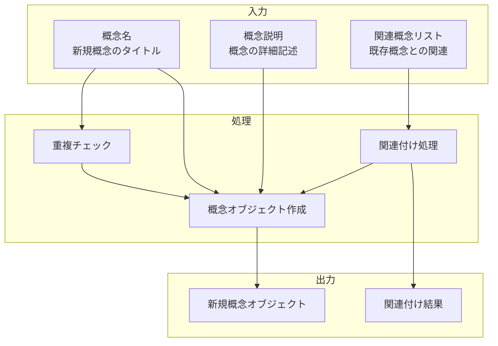

## 入力

### 概念名

- 新規に作成する概念のタイトルを受け取る
  - 概念を一意に識別するための基本情報として必要なため

### 概念説明

- 概念の詳細な記述内容を受け取る
  - 概念の意味と範囲を明確にして理解を促進するため

### 関連概念リスト

- 既存概念との関連情報を受け取る
  - 新規概念を個人の概念体系に適切に組み込むため

## 処理

### 重複チェック

- 既存概念名との重複を検査する
  - 同一概念の重複作成を防ぎ、概念体系の整合性を保つため
- 類似概念との差異を確認する
  - 微妙に異なる概念の混同を避けるため

### 関連付け処理

- 指定された関連概念との関連性を設定する
  - 概念間のネットワーク構造を構築するため
- 関連の種類と強度を定義する
  - 関連性の質を明確にして検索精度を向上させるため

### 概念オブジェクト作成

- 入力情報を統合して新規概念オブジェクトを生成する
  - システム内で管理可能な形式に変換するため
- 作成日時やメタデータを付与する
  - 概念の履歴管理と検索機能を支援するため

## 出力

### 新規概念オブジェクト

- 作成された概念の完全な情報を出力する
  - 後続処理や表示機能で利用できるようにするため

### 関連付け結果

- 確立された関連概念との結びつき情報を出力する
  - 概念ネットワークの更新状況を確認できるようにするため

## 備考

既存概念との重複チェック機能が必要

<!-- REFERENCE_END: concept-creation-implementation -->

### 質問テキスト入力フィールド

<!-- REFERENCE_BEGIN: question-text-implementation -->

## データフロー

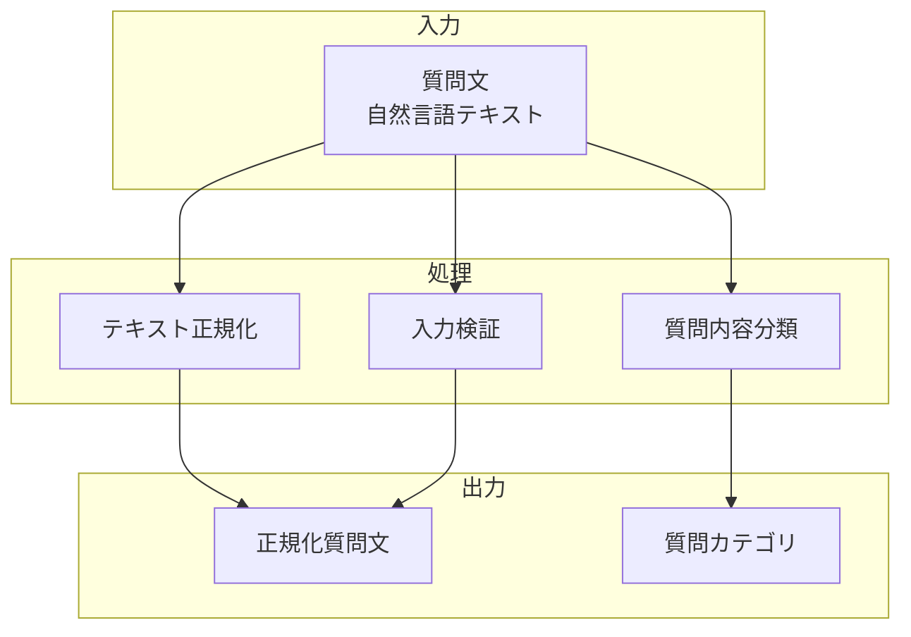

## 入力

### 質問文

- ユーザーが入力する質問の自然言語テキストを受け取る
  - 概念に関する疑問や検索意図を明確にするため

## 処理

### 質問内容分類

- 質問の種類を自動的に判定する
  - 適切な概念候補を提示するための前処理として必要なため
- 検索型・比較型・説明型の分類を実行する
  - 質問タイプに応じた最適な回答戦略を選択するため

### テキスト正規化

- 複数行テキストの統合と整形を行う
  - システムでの処理効率と検索精度を向上させるため
- 不要な改行や空白の除去を実行する
  - テキスト解析の精度を高めるため

### 入力検証

- 質問文の妥当性を確認する
  - 空文字列や無意味な入力を早期に検出するため
- 文字数制限とフォーマットをチェックする
  - システムの処理限界内での動作を保証するため

## 出力

### 正規化質問文

- 処理済みの質問テキストを出力する
  - 後続の概念検索処理で利用できるようにするため

### 質問カテゴリ

- 自動分類された質問の種別を出力する
  - 適切な概念候補提示戦略を選択できるようにするため

## 備考

複数行テキスト入力に対応が必要

<!-- REFERENCE_END: question-text-implementation -->

### グループ名・説明入力機能

<!-- REFERENCE_BEGIN: group-naming-implementation -->

## データフロー

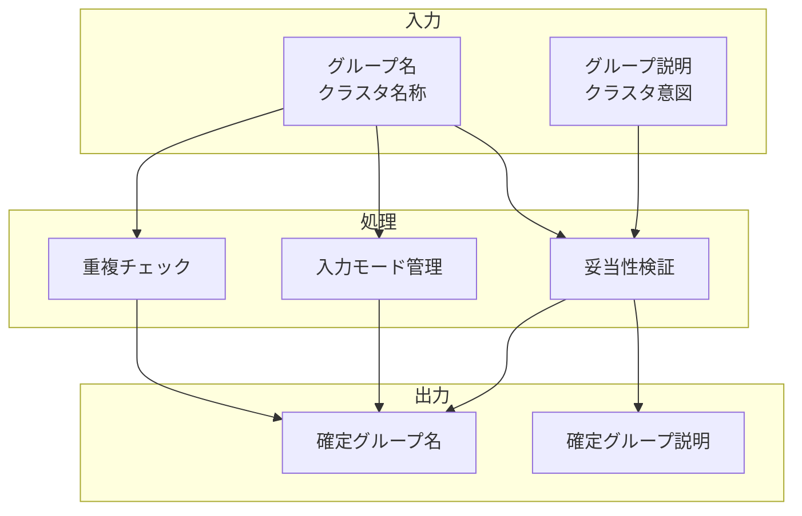

## 入力

### グループ名

- 形成された概念クラスタの名称を受け取る
  - クラスタを一意に識別し、後から参照できるようにするため

### グループ説明

- クラスタの意図や目的の詳細説明を受け取る
  - クラスタの意味と範囲を明確にして理解を促進するため

## 処理

### 重複チェック

- 既存グループ名との重複を検査する
  - 同一意味のグループの重複作成を防ぐため
- 類似グループとの差異を確認する
  - 細かな違いを持つグループの混同を避けるため

### 入力モード管理

- グループ選択状態での入力モードへの切り替えを管理する
  - ユーザー操作の文脈に応じた適切なタイミングで入力を可能にするため

### 妥当性検証

- グループ名と説明の妥当性を確認する
  - 空文字列や無意味な入力を防ぐため
- 文字数制限とフォーマットをチェックする
  - システムの表示と処理限界内での動作を保証するため

## 出力

### 確定グループ名

- 検証を通過したグループ名を出力する
  - クラスタの正式名称として登録し、後続処理で利用できるようにするため

### 確定グループ説明

- 検証を通過したグループ説明を出力する
  - クラスタの意味と目的を明確にし、将来の参照と編集を可能にするため

## 備考

グループ選択状態での入力モード切り替えが必要

<!-- REFERENCE_END: group-naming-implementation -->

### 関係定義・意味付け機能

<!-- REFERENCE_BEGIN: relationship-definition-implementation -->

## データフロー

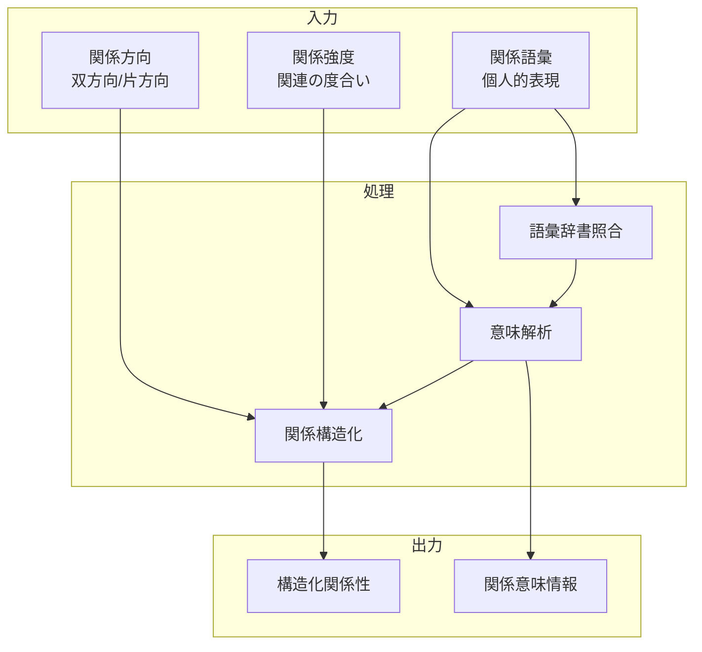

## 入力

### 関係語彙

- 個人的な表現で描述された関係性を受け取る
  - 直感的で自然な語彙で関係性を表現できるようにするため

### 関係方向

- 関係の方向性(双方向/片方向)を受け取る
  - 概念間の影響関係を正確にモデル化するため

### 関係強度

- 関連の度合いや重要度を受け取る
  - 関係性の優先度や検索時の重み付けに活用するため

## 処理

### 語彙辞書照合

- 個人の語彙辞書と照合して既知の表現を確認する
  - 一貫した関係表現と新しい表現の学習を実現するため

### 意味解析

- 関係語彙の意味とニュアンスを解析する
  - 曖昧な表現を明確な関係定義に変換するため
- コンテキストに応じた解釈を実行する
  - 同じ語彙でも状況によって異なる意味を持つことを考慮するため

### 関係構造化

- 解析された関係情報をシステムが処理できる形式に構造化する
  - 概念ネットワークでの検索や推論に活用できるようにするため
- 方向性と強度を統合した関係モデルを作成する
  - 複雑な関係性を体系的に管理できるようにするため

## 出力

### 構造化関係性

- システムが処理できる形式の関係定義を出力する
  - 概念ネットワークへの登録や検索機能で利用できるようにするため

### 関係意味情報

- 関係の意味やコンテキスト情報を出力する
  - 将来の関係性編集や解釈時の参考情報として活用できるようにするため

## 備考

個人の語彙辞書との連携が必要

<!-- REFERENCE_END: relationship-definition-implementation -->

## 選択操作コンポーネント

### 概念選択インターフェース

<!-- REFERENCE_BEGIN: concept-selection-implementation -->

## データフロー

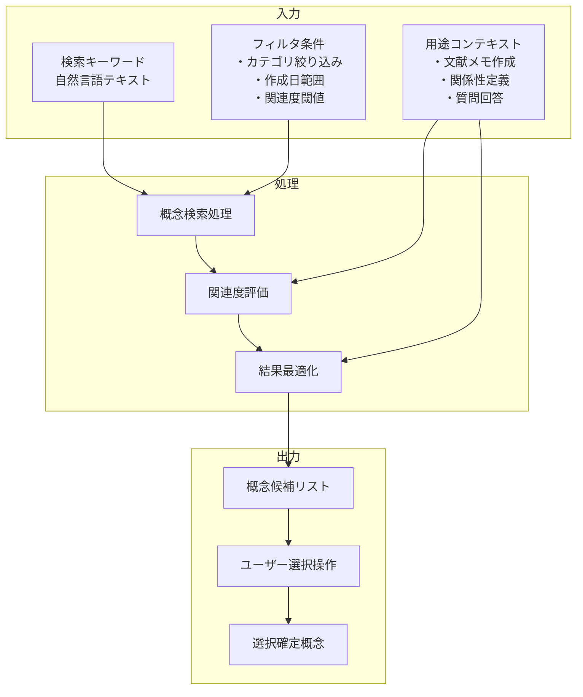

## 入力

### 検索キーワード

- 自然言語テキストで概念検索のクエリを受け取る
  - ユーザーが直感的に概念を探せるようにするため

### フィルタ条件

- カテゴリ・作成日・関連度閾値によるフィルタ条件を受け取る
  - 大量の概念から効率的に候補を絞り込むため
- ユーザーが設定可能な絞り込み基準を提供する
  - 検索結果の精度とパフォーマンスを両立するため

### 用途コンテキスト

- 文献メモ作成・関係性定義・質問回答の 3 つの用途を区別して受け取る
  - 同じ概念でも用途によって最適な選択候補が異なるため
- 用途ごとに異なる検索戦略を適用する
  - 文献メモ作成では最近使用概念、関係性定義では関連度重視にするため

## 処理

### 概念検索・フィルタリング

- 個人の概念データベースから検索キーワードに関連する概念を抽出する
  - ユーザーの個人的な概念体系から関連概念を発見するため
- フィルタ条件を適用して候補を絞り込む
  - 検索結果の精度を高め、選択作業を効率化するため

### 関連度評価

- 用途コンテキストに応じた関連度を計算する
  - 同じ概念でも使用場面によって重要度が変わるため
- 文献メモ作成時は最近使用概念を優遇し、関係性定義時は関連概念数重視で評価する
  - 用途ごとの最適な概念選択を支援するため

### 結果最適化

- 関連度に基づく順序付けを実行する
  - ユーザーが求める概念を上位に表示するため
- 用途別の表示最適化と適切な件数での結果提示を行う
  - 選択作業の認知負荷を軽減するため

## 出力

### 概念候補リスト

- 概念タイトル・関連度指標・概念プレビューを含む候補リストを提示する
  - ユーザーが概念の内容を事前に把握して適切な選択ができるようにするため
- ユーザーによる概念選択インターフェースを提供する
  - 直感的な選択操作を可能にするため
- 検索条件変更時の結果更新機能を実装する
  - リアルタイムでの概念探索を支援するため

### 選択確定概念

- システム内一意識別子と基本情報を出力する
  - 後続処理で概念を正確に特定できるようにするため
- 関連概念リストと紐付き文献メモ情報を含める
  - 選択した概念の周辺情報も活用できるようにするため
- カテゴリ・タグ・利用統計の分類情報を提供する
  - 概念の特性と使用状況を把握できるようにするため

## 備考

検索結果の関連度ランキング機能が必要

<!-- REFERENCE_END: concept-selection-implementation -->

### 概念候補選択インターフェース

<!-- REFERENCE_BEGIN: concept-candidates-implementation -->

## データフロー

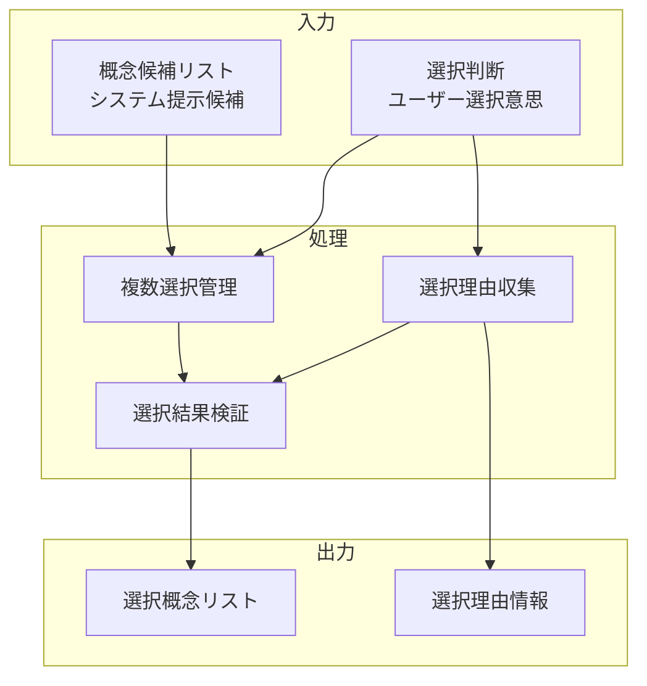

## 入力

### 概念候補リスト

- システムが提示した概念候補の一覧を受け取る
  - 質問内容に関連する概念を効率的に選択できるようにするため

### 選択判断

- ユーザーの選択・非選択の意思決定を受け取る
  - 関連概念を柔軟に組み合わせて回答精度を向上させるため

## 処理

### 複数選択管理

- チェックボックス形式での複数概念同時選択を管理する
  - 1 つの質問に対して複数の観点から回答を構築できるようにするため
- 選択状態の追跡と更新を実行する
  - ユーザーが選択内容を自由に変更できるようにするため

### 選択理由収集

- 各概念を選択した理由をオプションで収集する
  - 選択根拠を記録して将来の参考にできるようにするため
- 理由の妥当性を確認する
  - 無意味な選択を防ぎ、質の高い概念組み合わせを実現するため

### 選択結果検証

- 選択された概念の組み合わせ妥当性を検証する
  - 矛盾する概念の同時選択を防ぐため
- 最低選択数と最大選択数の制限を適用する
  - 効果的な回答生成に適した概念数を保証するため

## 出力

### 選択概念リスト

- 最終的に選択確定された概念の一覧を出力する
  - 後続の回答生成処理で利用できるようにするため

### 選択理由情報

- 各概念の選択理由と関連情報を出力する
  - 回答の根拠を明確にし、学習効果を高めるため

## 備考

複数選択可能なチェックボックス形式

<!-- REFERENCE_END: concept-candidates-implementation -->

## 直接操作コンポーネント

### 空間配置インターフェース

<!-- REFERENCE_BEGIN: spatial-arrangement-implementation -->

## データフロー

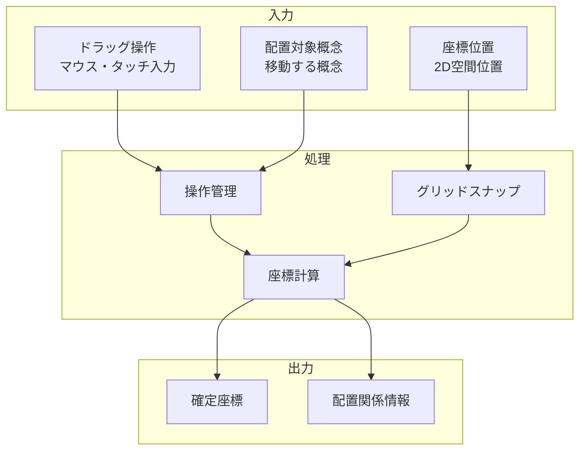

## 入力

### ドラッグ操作

- マウスドラッグやタッチ操作による概念移動指示を受け取る
  - 直感的な操作で概念の空間配置を変更できるようにするため

### 座標位置

- 2D 平面上での目標配置位置を受け取る
  - 概念間の関係性を空間的に表現できるようにするため

### 配置対象概念

- 移動・配置する概念オブジェクトを受け取る
  - 特定の概念を意図した位置に配置できるようにするため

## 処理

### 操作管理

- ドラッグ&ドロップ操作の開始・継続・終了を管理する
  - スムーズな操作体験と正確な配置を実現するため
- 複数概念の同時操作を制御する
  - 操作の混乱を防ぎ、意図した配置を可能にするため

### グリッドスナップ

- 座標をグリッドに吸着させる処理を実行する
  - 整然とした配置と概念間の適切な距離を保証するため
- スナップ感度と範囲を調整する
  - ユーザーの意図を尊重しつつ整列効果を提供するため

### 座標計算

- 最終的な配置座標を計算し更新する
  - 概念の新しい位置を正確に記録するため
- 他概念との衝突回避を実行する
  - 概念の重複配置を防ぎ、視認性を保つため

## 出力

### 確定座標

- 処理完了後の概念の最終座標を出力する
  - 空間配置情報として保存し、表示に反映できるようにするため

### 配置関係情報

- 概念間の空間的関係性情報を出力する
  - 近接概念の自動グループ化や関係性推定に活用するため

## 備考

2D 平面での自由配置とグリッドスナップ機能

<!-- REFERENCE_END: spatial-arrangement-implementation -->

## 表示・視覚化コンポーネント

### 概念カード UI

<!-- REFERENCE_BEGIN: concept-cards-implementation -->

## データフロー

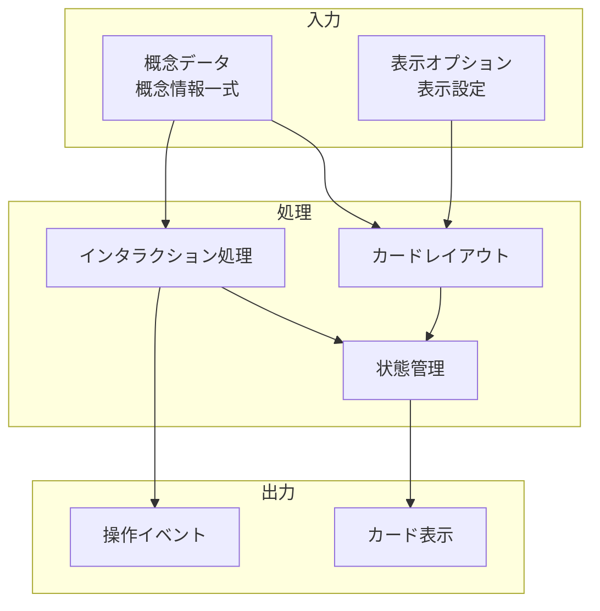

## 入力

### 概念データ

- 表示対象となる概念の完全な情報を受け取る
  - カード上で概念の内容を適切に表現するため

### 表示オプション

- カードの表示方法や詳細レベルの設定を受け取る
  - 利用場面に応じた最適な情報提示を実現するため

## 処理

### カードレイアウト

- 概念情報をカード形式で整理し表示レイアウトを構築する
  - 視覚的に理解しやすい形で概念を提示するため
- 情報の優先度に応じた表示領域を配分する
  - 重要な情報を効果的に強調表示するため

### インタラクション処理

- ホバー時の詳細表示とクリック操作を処理する
  - 段階的な情報開示とスムーズな操作を実現するため
- マウス・タッチ操作への適切な反応を提供する
  - デバイスに応じた自然な操作感を提供するため

### 状態管理

- カードの選択状態・アクティブ状態を管理する
  - ユーザーの操作状況を視覚的にフィードバックするため
- 複数カード間の状態連携を制御する
  - 一貫した操作体験を保証するため

## 出力

### カード表示

- 整理された概念情報のカード形式表示を出力する
  - ユーザーが概念を視覚的に理解できるようにするため

### 操作イベント

- ユーザーのカード操作情報を出力する
  - 後続処理で概念選択や詳細表示を実行できるようにするため

## 備考

ホバー時の詳細表示とクリック操作に対応

<!-- REFERENCE_END: concept-cards-implementation -->

### 文献メモ一覧表示機能

<!-- REFERENCE_BEGIN: memo-list-implementation -->

## データフロー

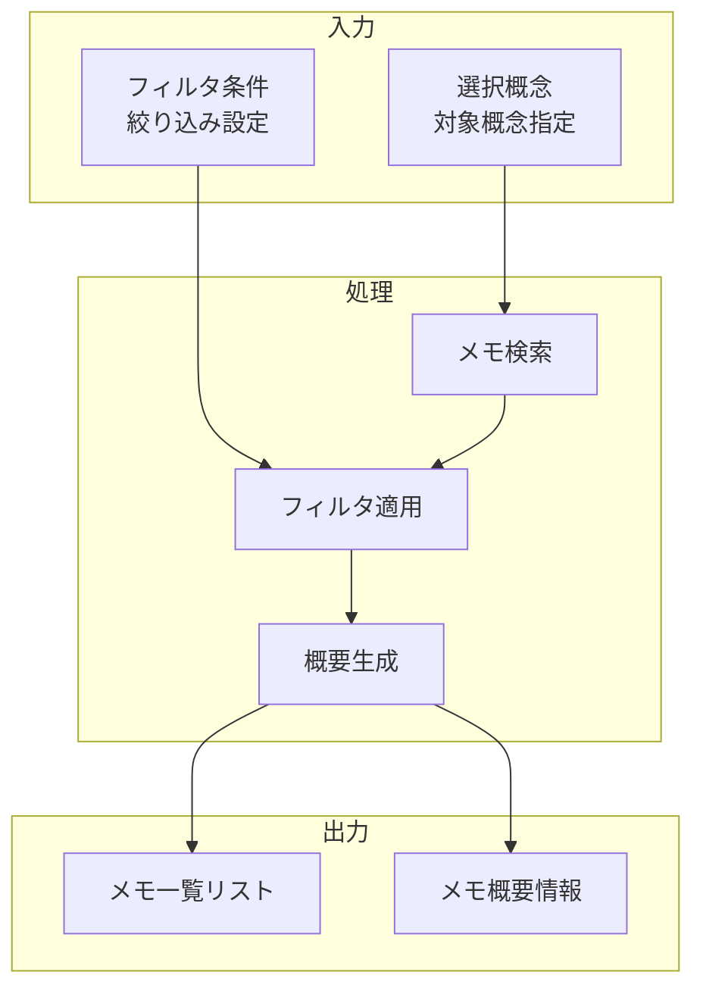

## 入力

### 選択概念

- 文献メモを表示する対象となる概念を受け取る
  - 特定概念に関連する知識を一覧できるようにするため

### フィルタ条件

- メモの絞り込み条件や表示オプションを受け取る
  - 大量のメモから目的に合った情報を効率的に取得できるようにするため

## 処理

### メモ検索

- 指定された概念に紐付いた文献メモを検索する
  - 概念と関連する学習内容を網羅的に収集するため
- 関連度や作成日順でソートを実行する
  - 最も関連性が高いメモを優先表示するため

### フィルタ適用

- 指定された条件に基づいてメモを絞り込む
  - 作成日、更新日、メモタイプなどの条件で絞り込むため
- 表示件数の制限とページングを実行する
  - パフォーマンスと可読性のバランスを保つため

### 概要生成

- 各メモの概要情報を生成する
  - 一覧でメモの内容を把握できるようにするため
- メモの重要度や特徴を抽出する
  - 優先的に読むべきメモを判別できるようにするため

## 出力

### メモ一覧リスト

- フィルタ適用後のメモ一覧を出力する
  - ユーザーが関連メモを一覧できるようにするため

### メモ概要情報

- 各メモの要点とメタデータを出力する
  - 詳細表示に進む前にメモの价値を判断できるようにするため

## 備考

TBD

<!-- REFERENCE_END: memo-list-implementation -->

### メモ詳細表示機能

<!-- REFERENCE_BEGIN: memo-detail-implementation -->

## データフロー

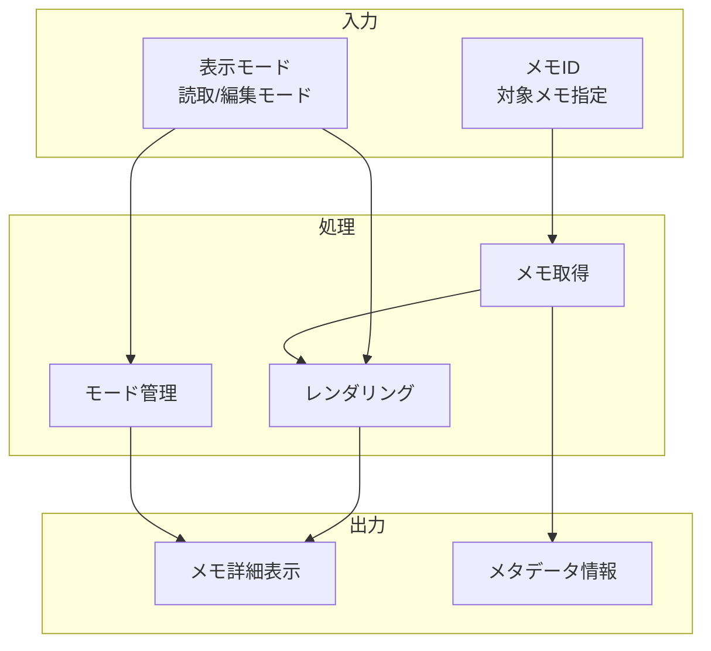

## 入力

### メモ ID

- 表示対象となる文献メモの一意識別子を受け取る
  - 特定のメモを正確に特定して詳細表示できるようにするため

### 表示モード

- 読取専用モードか編集可能モードかの指定を受け取る
  - 利用目的に応じた最適なインターフェースを提供するため

## 処理

### メモ取得

- 指定されたメモ ID に対応する詳細情報を取得する
  - メモの全内容と関連情報を収集するため
- 関連概念や参考情報を併せて取得する
  - メモの文脈と背景を理解できるようにするため

### レンダリング

- 表示モードに応じたメモ内容のレンダリングを実行する
  - 読取モードでは整形された表示、編集モードでは編集可能な形式で提供するため
- Markdown のパースやコードハイライトを実行する
  - 技術文書やコードサンプルを読みやすく表示するため

### モード管理

- 読取モードと編集モード間の切り替えを管理する
  - シームレスなモード変更でユーザー体験を向上させるため
- 編集時の変更状態追跡を行う
  - 未保存変更の紛失を防ぐため

## 出力

### メモ詳細表示

- モードに応じて適切にレンダリングされたメモ内容を出力する
  - ユーザーがメモを効果的に閲覧・編集できるようにするため

### メタデータ情報

- メモの作成日、更新日、関連概念などの付帯情報を出力する
  - メモの文脈や履歴を把握できるようにするため

## 備考

編集モードとの切り替え機能が必要

<!-- REFERENCE_END: memo-detail-implementation -->

### 近接度ベースクラスタ認識・境界表示機能

<!-- REFERENCE_BEGIN: cluster-recognition-implementation -->

## データフロー

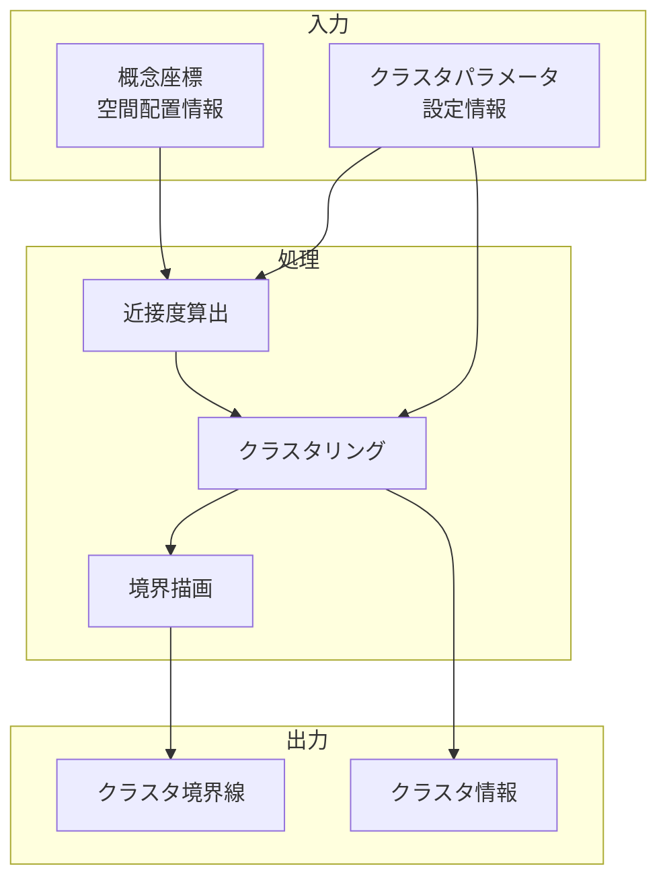

## 入力

### 概念座標

- 空間上に配置された各概念の 2D 座標情報を受け取る
  - 概念間の空間的近さを計算して関連性を推定するため

### クラスタパラメータ

- クラスタ認識の閾値や感度設定を受け取る
  - ユーザーの意図に合った適切なグループ化を実現するため

## 処理

### 近接度算出

- 各概念間の空間的距離を算出し近接度を評価する
  - 関連性の高い概念グループを特定するため
- 距離闾値や重み付けを適用する
  - ユーザーが意図したグループ化を適切に反映するため

### クラスタリング

- 近接度ベースで概念をグループ化しクラスタを形成する
  - 空間上で近い位置にある概念を関連グループとして認識するため
- 動的なクラスタ更新を管理する
  - 概念の配置変更に応じてリアルタイムでグループを再編成するため

### 境界描画

- 認識されたクラスタの周囲に視覚的境界線を描画する
  - ユーザーが概念グループを直感的に理解できるようにするため
- 境界線のスタイルや色を調整する
  - クラスタの特性や重要度を視覚的に表現するため

## 出力

### クラスタ境界線

- 各クラスタを囲む視覚的境界線を出力する
  - 概念グループの範囲を明確に表示して理解を助けるため

### クラスタ情報

- 各クラスタの概念数、中心座標、特徴情報を出力する
  - クラスタの性質を把握し、名前付けや編集に活用できるようにするため

## 備考

動的クラスタ更新とユーザー調整機能が必要

<!-- REFERENCE_END: cluster-recognition-implementation -->

## 編集操作コンポーネント

### 要約修正エディタ

<!-- REFERENCE_BEGIN: summary-editor-implementation -->

## データフロー

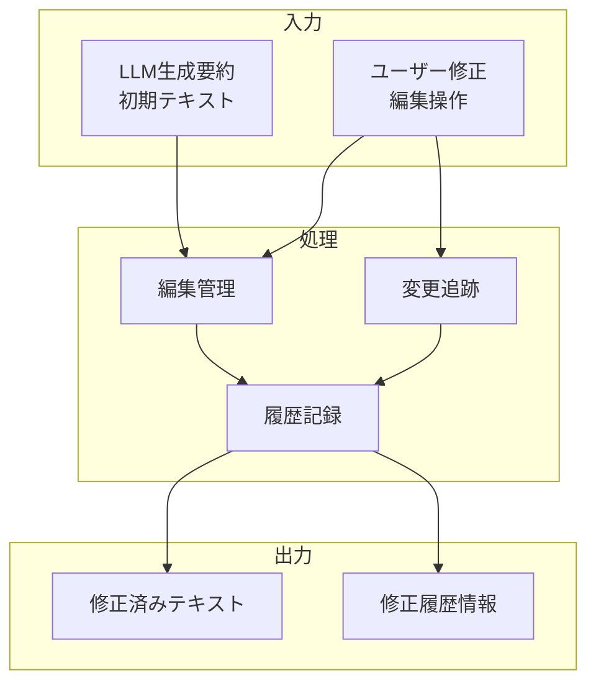

## 入力

### LLM 生成要約

- LLM が自動生成した初期要約テキストを受け取る
  - 個人の理解や観点を反映させるためのベースとして必要なため

### ユーザー修正

- ユーザーによるテキスト編集、追加、削除の操作を受け取る
  - 機械的な要約を個人的な視点や体験を組み込んだ内容に変換するため

## 処理

### 編集管理

- リアルタイムでのテキスト編集機能を管理する
  - スムーズな編集体験で思考の流れを中断させないようにするため
- カーソル位置や選択範囲の管理を実行する
  - 正確な編集位置で意図した修正を可能にするため

### 変更追跡

- ユーザーの編集操作をリアルタイムで追跡し変更箇所をハイライトする
  - 変更内容を視覚的に把握し、修正の精度を向上させるため
- 変更の種類(追加/修正/削除)を分類して管理する
  - 修正の意図や影響範囲を明確にするため

### 履歴記録

- 編集操作の履歴を時系列で記録し管理する
  - 将来の参照や学習効果の検証に活用できるようにするため
- 主要な変更ポイントとその理由を記録する
  - 修正の意図や思考プロセスを後から振り返えるようにするため

## 出力

### 修正済みテキスト

- ユーザーの修正を反映した最終的な要約テキストを出力する
  - 個人的な理解や観点が組み込まれた価値あるコンテンツとして活用できるようにするため

### 修正履歴情報

- 編集過程の詳細情報と主要変更ポイントを出力する
  - 学習効果の検証や今後の改善に活用できるようにするため

## 備考

リアルタイム編集と変更ハイライト機能が必要

<!-- REFERENCE_END: summary-editor-implementation -->

## データ保存コンポーネント

### 文献メモ保存機能

<!-- REFERENCE_BEGIN: literature-memo-implementation -->

## データフロー

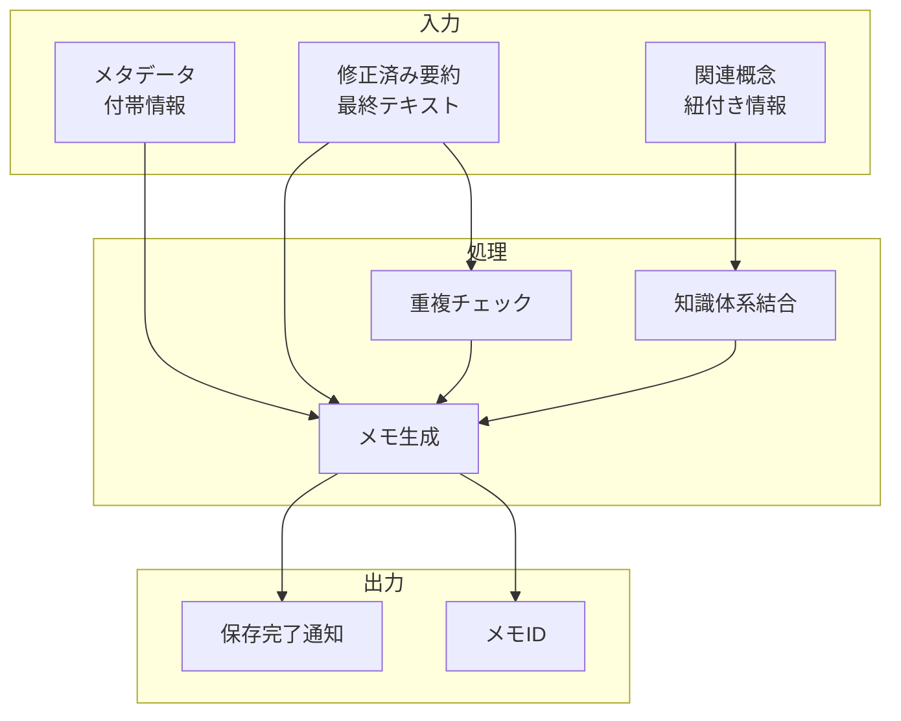

## 入力

### 修正済み要約

- ユーザーが編集完了した最終的な要約テキストを受け取る
  - 個人の観点や理解が組み込まれた価値あるコンテンツとして保存するため

### 関連概念

- メモと紐付ける概念の情報と関連度を受け取る
  - 概念中心の知識体系に適切に組み込むため

### メタデータ

- 作成日、更新日、ソース URL などの付帯情報を受け取る
  - メモの文脈や信頼性を管理し、将来の参照を支援するため

## 処理

### 重複チェック

- 既存メモとの内容重複や類似性を検出する
  - 同一内容の重複保存を防ぎ、知識体系の整合性を保つため
- 重複発見時の統合方法を提案する
  - 既存情報との結合や更新でより豊かな内容を作成するため

### 知識体系結合

- 指定された関連概念との結合関係を構築する
  - 概念ネットワーク内での検索や関連情報探索を可能にするため
- 概念間の関連度や影響度を更新する
  - 新しいメモの追加による概念間関係の変化を反映するため

### メモ生成

- 入力情報を統合してシステム内で管理可能なメモオブジェクトを生成する
  - 永続的な保存と効率的な検索を実現するため
- 一意なメモ ID とインデックス情報を付与する
  - 高速なアクセスと他メモとの関連付けを可能にするため

## 出力

### 保存完了通知

- メモの保存完了状態と結果情報を出力する
  - ユーザーに保存成功を明確にフィードバックし、安心感を提供するため

### メモ ID

- 保存されたメモの一意識別子を出力する
  - 後続のメモ参照や編集操作で利用できるようにするため

## 備考

重複保存の検出と統合機能が必要

<!-- REFERENCE_END: literature-memo-implementation -->

### 関係性ネットワーク記録機能

<!-- REFERENCE_BEGIN: relationship-network-implementation -->

## データフロー

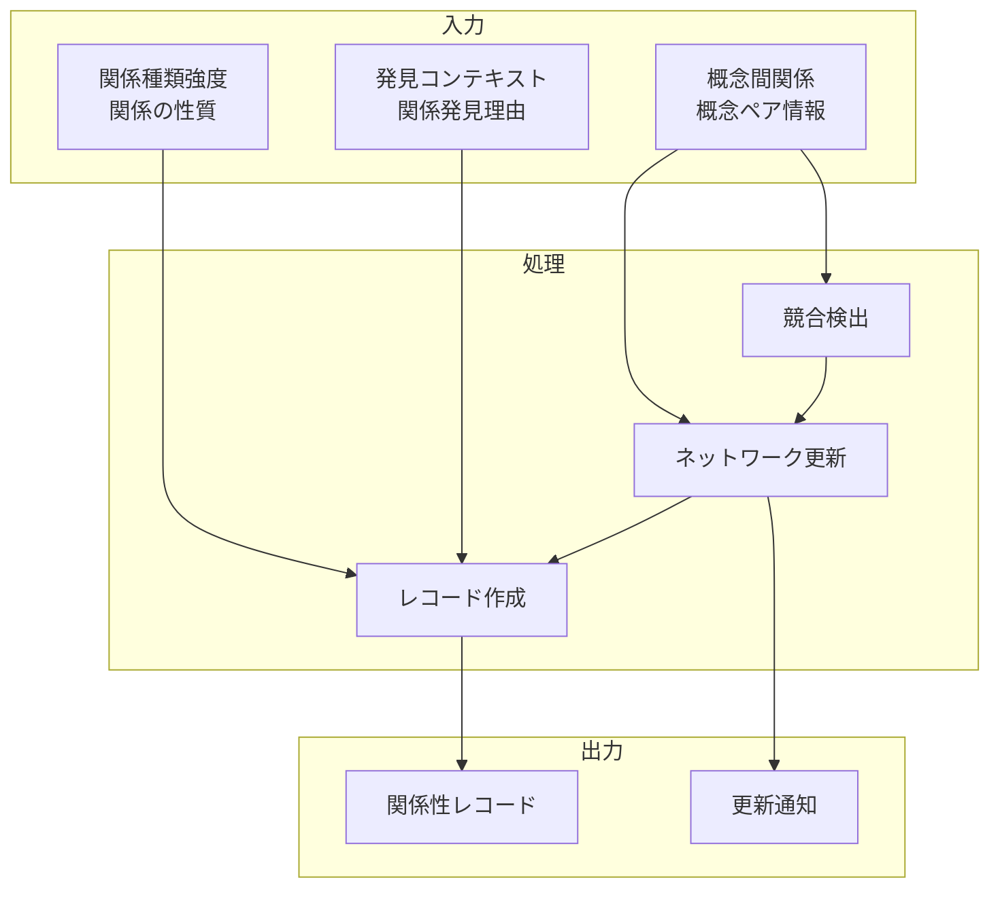

## 入力

### 概念間関係

- 新たに発見された概念ペアとその関係性情報を受け取る
  - 概念ネットワークを拡張して知識の関連性を豊かにするため

### 関係種類強度

- 関係の種類(原因結果、類似性など)と強度情報を受け取る
  - 関係性の質を明確にして、適切な文脈で活用できるようにするため

### 発見コンテキスト

- 関係性を発見した状況や理由の情報を受け取る
  - 関係性の信頼性や適用範囲を判断できるようにするため

## 処理

### 競合検出

- 既存の関係性との競合や矛盾を検出する
  - 一貫した概念ネットワークを維持し、矛盾する情報の混在を防ぐため
- 競合解決の方法を提案する
  - 異なる観点や文脈での関係性を適切に統合するため

### ネットワーク更新

- 概念ネットワーク全体への新しい関係性の統合を実行する
  - ネットワークの構造やクラスタを動的に更新するため
- 関連する他の関係性への影響を評価する
  - 新しい関係性が既存の概念間関係に与える影響を把握するため

### レコード作成

- 関係性情報をシステム内で管理可能な形式のレコードとして作成する
  - 永続的な保存と効率的な検索を実現するため
- 関係性のメタデータとインデックスを付与する
  - 関係性ベースの検索や推論を高速化するため

## 出力

### 関係性レコード

- 新たに登録された関係性の完全な情報を出力する
  - 後続の関係性検索や編集で利用できるようにするため

### 更新通知

- ネットワーク更新の完了状態と影響範囲を出力する
  - ユーザーに概念ネットワークの変化を明確にフィードバックするため

## 備考

既存関係との競合解決機能が必要

<!-- REFERENCE_END: relationship-network-implementation -->
