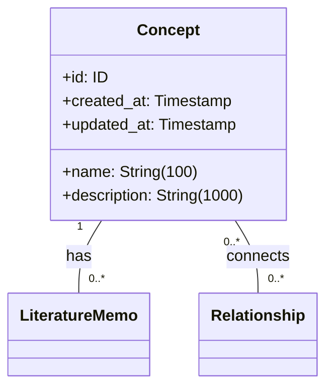
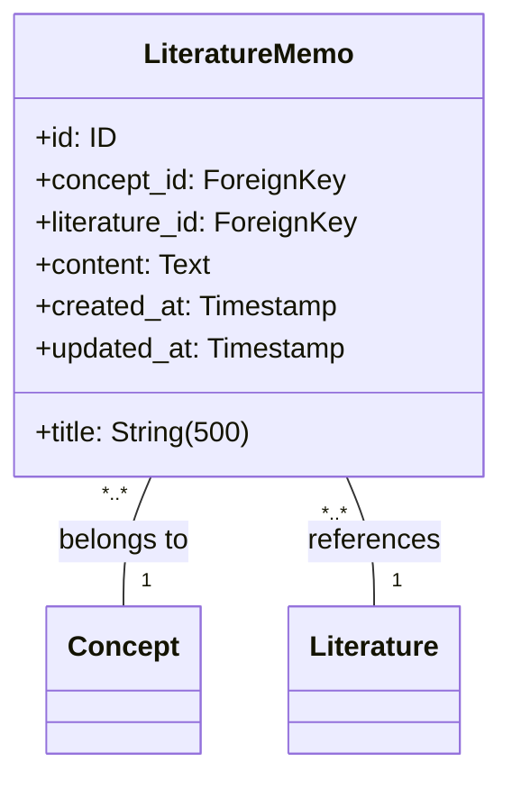
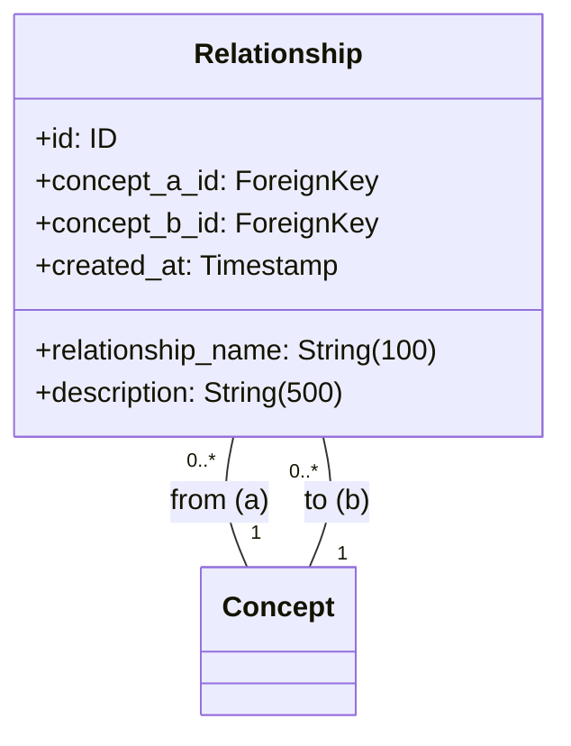
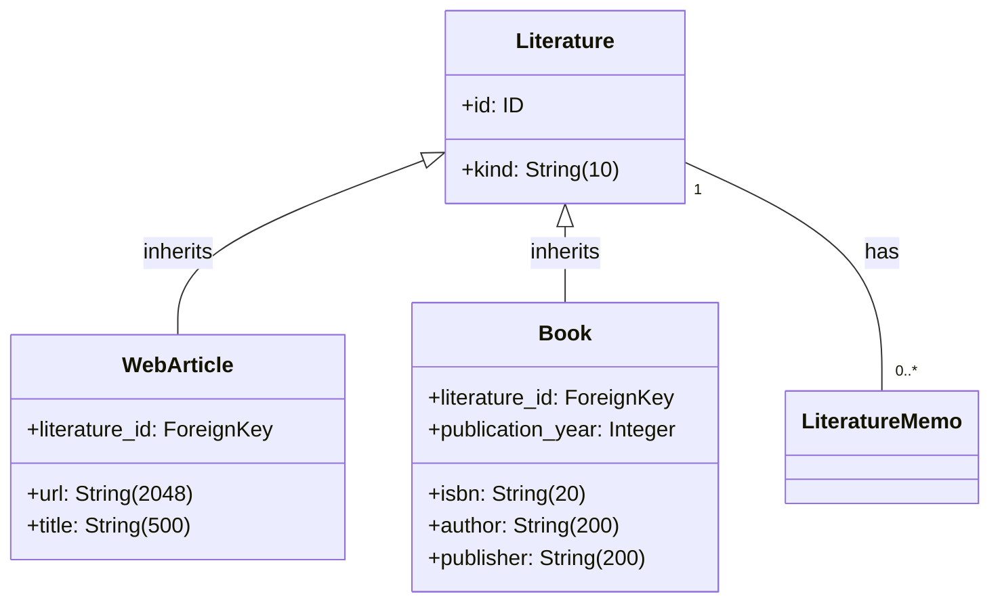

<!-- markdownlint-disable MD024 -->

# Domain

## ドメインコンポーネント契約

### 概念エンティティ仕様

<!-- REFERENCE_BEGIN: concept-entity-specification -->

### エンティティ構造

### 属性制約

- **name**: 空文字列禁止、最大 100 文字、一意
- **description**: 最大 1000 文字、必須
- **id, created_at, updated_at**: 自動設定

### 不変条件

- name は空文字列でない
- name は知識体系内で一意
- created_at と updated_at は必ず存在
- updated_at ≧ created_at

### ビジネスルール

#### 名前の一意性

同名の概念が複数存在すると、個人の理解体系が曖昧になり、文献メモや関係性の紐付けが混乱するため、一意制約を設ける。

#### 最小限の属性

概念自体はシンプルな抽象化であり、具体的な知識内容は文献メモが保持する責務である。

### 関係性制約

- **文献メモとの関係**: 1 対多、概念削除時は ON DELETE RESTRICT でアプリケーション層が制御
- **関係性との関係**: 多対多(無向グラフ)、概念削除時は ON DELETE RESTRICT でアプリケーション層が制御

<!-- REFERENCE_END: concept-entity-specification -->

### 文献メモエンティティ仕様

<!-- REFERENCE_BEGIN: literature-memo-entity-specification -->

### エンティティ構造

### 属性制約

- **title**: 空文字列禁止、最大 500 文字
- **content**: 空文字列禁止
- **concept_id**: 必須、外部キー(Concept)
- **literature_id**: 必須、外部キー(Literature)
- **id, created_at, updated_at**: 自動設定

### 不変条件

- title は空文字列でない
- content は空文字列でない
- concept_id は必ず存在し、有効な概念を参照
- literature_id は必ず存在し、有効な文献を参照
- created_at と updated_at は必ず存在
- updated_at ≧ created_at

### ビジネスルール

#### 概念との必須関連

文献メモは必ず 1 つの概念に紐づく。概念ベースの知識体系構築という中核的価値を保証するため。

#### 文献との必須関連

文献メモは必ず 1 つの文献に紐づく。外部情報を個人の理解に変換するというプロセスの透明性を保証するため。

#### 内容の個人化

LLM が生成した要約をそのまま保存するのではなく、個人が理解した形に編集することで、真の知識統合が実現される。

### 関係性制約

- **概念との関係**: 多対 1、概念削除時は ON DELETE RESTRICT でアプリケーション層が制御
- **文献との関係**: 多対 1、文献削除時は ON DELETE RESTRICT でアプリケーション層が制御

<!-- REFERENCE_END: literature-memo-entity-specification -->

### 関係性エンティティ仕様

<!-- REFERENCE_BEGIN: relationship-entity-specification -->

### エンティティ構造

### 属性制約

- **relationship_name**: 空文字列禁止、最大 100 文字
- **description**: 最大 500 文字、空文字列許容
- **concept_a_id, concept_b_id**: 必須、外部キー(Concept)、concept_a_id < concept_b_id
- **複合 UNIQUE 制約**: (concept_a_id, concept_b_id, relationship_name)
- **id, created_at**: 自動設定

### 不変条件

- relationship_name は空文字列でない
- concept_a_id < concept_b_id (無向グラフ正規化)
- concept_a_id は必ず存在し、有効な概念を参照
- concept_b_id は必ず存在し、有効な概念を参照
- (concept_a_id, concept_b_id, relationship_name) は一意
- created_at は必ず存在

### ビジネスルール

#### 無向グラフの正規化

概念 A と B の関係は一方向のみ記録される。CHECK 制約により concept_a_id < concept_b_id が保証され、重複する関係性の登録が防止される。

#### 個人的関係語彙

関係名は個人が自由に定義できる。形式的なオントロジーに縛られず、個人の理解に基づいた自然な表現を使用する。

#### 同一概念間の複数関係許可

同一の概念ペア間に複数の異なる関係性を定義できる。UNIQUE 制約により同一関係名の重複は防止しつつ、多面的な関係性の表現を可能にする。

### 関係性制約

- **概念との関係**: 多対多(無向グラフ)、概念削除時は ON DELETE RESTRICT でアプリケーション層が制御

<!-- REFERENCE_END: relationship-entity-specification -->

### 文献エンティティ仕様

<!-- REFERENCE_BEGIN: literature-entity-specification -->

### エンティティ構造

### 属性制約

**Literature (基底)**:

- **kind**: 'web' または 'book'、必須
- **id**: 自動設定

**WebArticle (派生)**:

- **url**: 空文字列禁止、最大 2048 文字
- **title**: 空文字列禁止、最大 500 文字
- **literature_id**: PRIMARY KEY、外部キー(Literature)

**Book (派生)**:

- **isbn**: 空文字列禁止、最大 20 文字、一意
- **author**: 空文字列禁止、最大 200 文字
- **publisher**: 空文字列禁止、最大 200 文字
- **publication_year**: 必須
- **literature_id**: PRIMARY KEY、外部キー(Literature)

### 不変条件

- kind は 'web' または 'book'
- kind = 'web' なら web_article レコードが存在
- kind = 'book' なら book レコードが存在
- WebArticle: url と title は空文字列でない
- Book: isbn, author, publisher は空文字列でない
- Book: isbn は一意

### ビジネスルール

#### 継承テーブル構造

CTI(Class Table Inheritance)により、基底テーブル(Literature)と派生テーブル(WebArticle/Book)に分離。型安全性と拡張性を確保。

#### 書誌情報のシンプル性

文献の内容そのものは保持せず、文献メモが個人の理解として保持する責務である。

#### 複数観点からの読み直し

同一文献を複数の概念の観点で読み直すことを許可する。一つの文献から複数の文献メモが生成され、多面的な知識統合が実現される。

### 関係性制約

- **文献メモとの関係**: 1 対多、文献削除時は ON DELETE RESTRICT でアプリケーション層が制御

<!-- REFERENCE_END: literature-entity-specification -->
