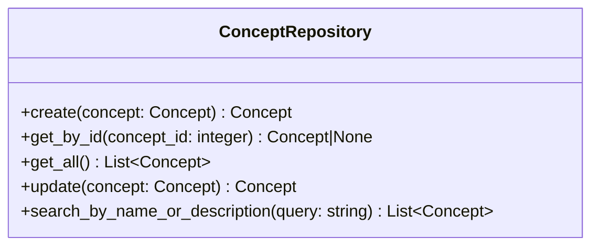
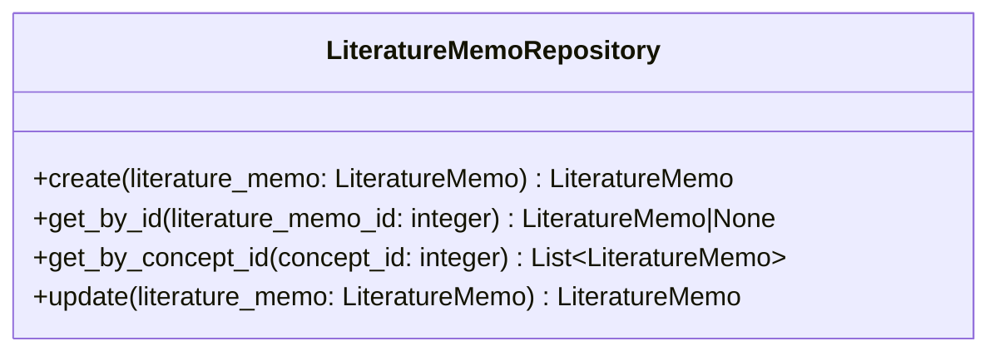
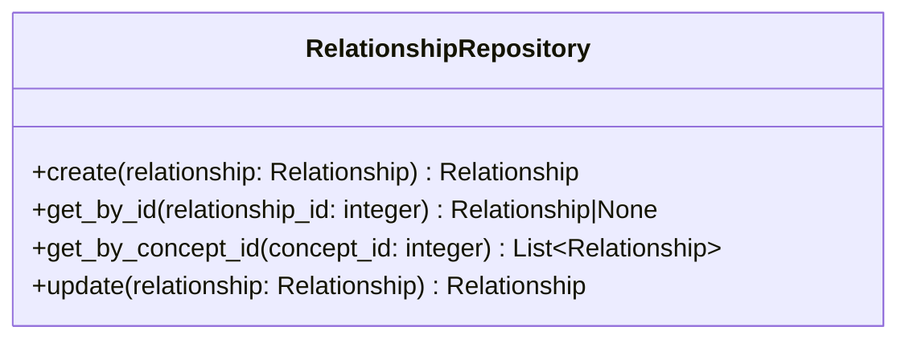
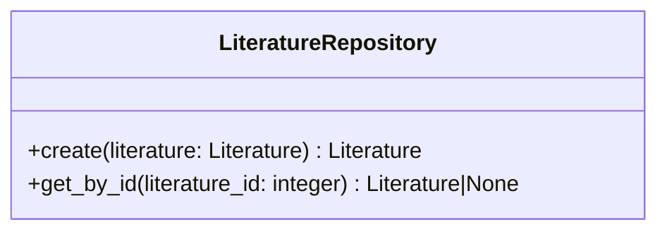
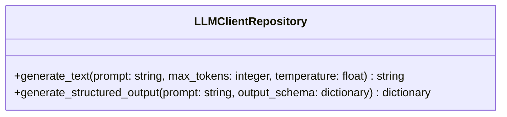
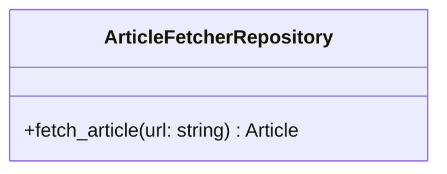

<!-- markdownlint-disable MD024 -->

# Component レベル実装契約集

## 概要

C4 モデルの Component レベルで定義された実装契約を統合する。ドメインコンポーネント、API 仕様、UI コンポーネント、データアクセスコンポーネントの 4 つの Component 群における設計判断を集約し、実装の詳細仕様を提供する。

## Repository コンポーネント契約

### 概念 Repository 仕様

<!-- REFERENCE_BEGIN: concept-repository-specification -->

概念 Repository 仕様として以下を定義する。

### 概念 Repository の責務

概念エンティティのデータアクセスを提供する。SQLAlchemy ORM モデルと Domain エンティティの変換、CRUD 操作、名前・説明による検索を実装する。

### 概念 Repository のインターフェース

### 概念 Repository の実装方針

- ORM モデルと Domain モデルは 1:1 対応で構造を揃える
- インデックスを活用した効率的な検索を実現する
- トランザクション境界は Application 層で制御し、Repository は単一操作のみを提供する

<!-- REFERENCE_END: concept-repository-specification -->

### 文献メモ Repository 仕様

<!-- REFERENCE_BEGIN: literature-memo-repository-specification -->

文献メモ Repository 仕様として以下を定義する。

### 文献メモ Repository の責務

文献メモエンティティのデータアクセスを提供する。SQLAlchemy ORM モデルと Domain エンティティの変換、CRUD 操作、概念別一覧取得を実装する。

### 文献メモ Repository のインターフェース

### 文献メモ Repository の実装方針

- ORM モデルと Domain モデルは 1:1 対応で構造を揃える
- 外部キー参照は ID のみを保持し、関連エンティティの取得は必要に応じて別途行う
- インデックスを活用した効率的な概念別取得を実現する
- トランザクション境界は Application 層で制御し、Repository は単一操作のみを提供する

<!-- REFERENCE_END: literature-memo-repository-specification -->

### 関係性 Repository 仕様

<!-- REFERENCE_BEGIN: relationship-repository-specification -->

関係性 Repository 仕様として以下を定義する。

### 関係性 Repository の責務

関係性エンティティのデータアクセスを提供する。SQLAlchemy ORM モデルと Domain エンティティの変換、CRUD 操作、概念 ID による関係性取得を実装する。

### 関係性 Repository のインターフェース

### 関係性 Repository の実装方針

- ORM モデルと Domain モデルは 1:1 対応で構造を揃える
- 無向グラフの正規化制約(concept_a_id < concept_b_id)を維持する
- 概念 ID による取得では concept_a_id と concept_b_id の両方を検索する
- トランザクション境界は Application 層で制御し、Repository は単一操作のみを提供する

<!-- REFERENCE_END: relationship-repository-specification -->

### 文献 Repository 仕様

<!-- REFERENCE_BEGIN: literature-repository-specification -->

文献 Repository 仕様として以下を定義する。

### 文献 Repository の責務

文献エンティティのデータアクセスを提供する。SQLAlchemy ORM モデルと Domain エンティティの変換、CRUD 操作を実装する。

### 文献 Repository のインターフェース

### 文献 Repository の実装方針

- ORM モデルと Domain モデルは 1:1 対応で構造を揃える
- 文献の作成と読み取りのみを提供する(更新・削除は優先度低)
- トランザクション境界は Application 層で制御し、Repository は単一操作のみを提供する

<!-- REFERENCE_END: literature-repository-specification -->

### LLM クライアント Repository 仕様

<!-- REFERENCE_BEGIN: llm-client-repository-specification -->

LLM クライアント Repository 仕様として以下を定義する。

### LLM クライアント Repository の責務

- 外部 LLM API との HTTP 通信を提供する。
- LLM API のリクエスト/レスポンス形式を内部データ構造に変換する。
- リトライ処理とタイムアウト処理を実装する。
- API の利用制限に対応する。

### LLM クライアント Repository のインターフェース

### LLM クライアント Repository の実装方針

- LLM API の実装詳細を Application 層から隠蔽する。
- プロンプトテンプレートの管理は Application 層の責務とする。
- リトライとバックオフ戦略を実装する。
- タイムアウト処理を実装する。
- API の利用制限を考慮した実装を行う。

<!-- REFERENCE_END: llm-client-repository-specification -->

### 記事取得 Repository 仕様

<!-- REFERENCE_BEGIN: article-fetcher-repository-specification -->

記事取得 Repository 仕様として以下を定義する。

### 記事取得 Repository の責務

- 指定 URL から Web 記事を取得する。
- HTML から本文テキストを抽出する。
- タイムアウト処理とリトライ処理を実装する。
- 適切な User-Agent を設定する。

### 記事取得 Repository のインターフェース

### 記事取得 Repository の実装方針

- HTML 取得と本文抽出の実装詳細を Application 層から隠蔽する。
- タイムアウトとリトライを実装する。
- 適切な User-Agent を設定する。

<!-- REFERENCE_END: article-fetcher-repository-specification -->
